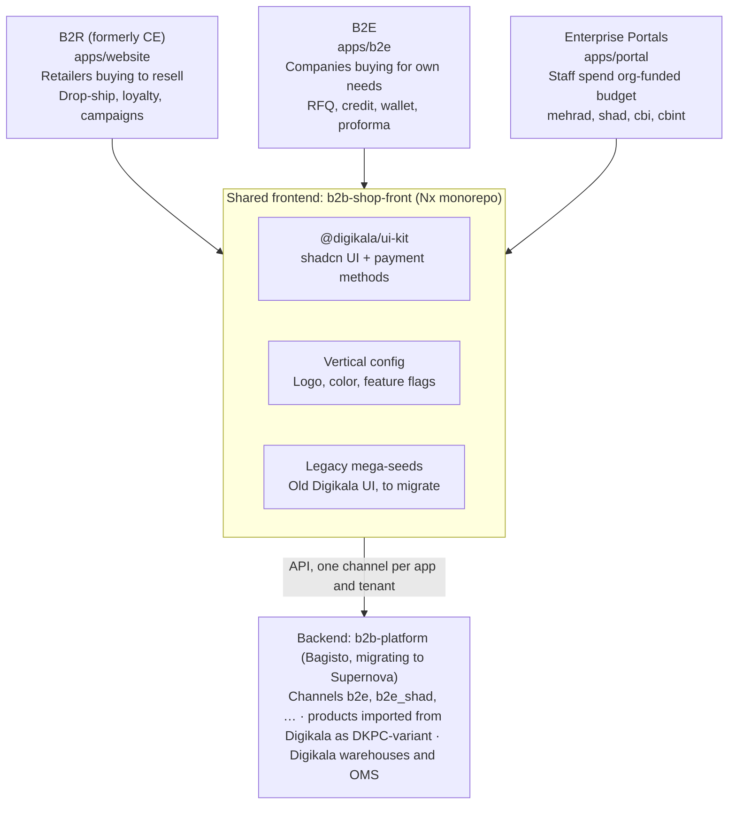
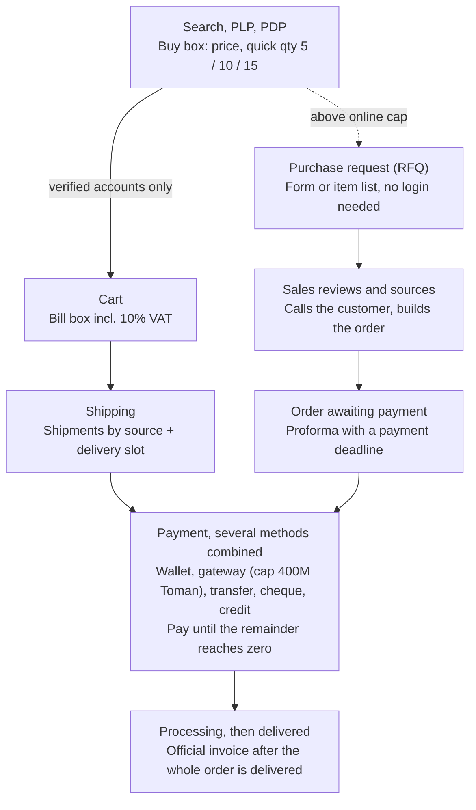

# B2E Foundation — Product & Design Knowledge Base

> **Knowledge-base copy.** Exported on 19 Oct 2026 from the living doc [B2E Foundation](https://claude.ai/code/artifact/13b539f1-320f-440b-8c2f-9a635dfd6653), which stays the source of truth. Diagrams are converted to Mermaid or tables; status chips are plain text.

Oct 19, 2026 · @Panah

## How to use this doc

This is the single reference a designer (or the future AI design agent) reads before designing anything for B2E. It covers B2E in depth and the layers B2E shares with B2R and the Enterprise Portals. Every fact was read from a named source on 2026-10-19; nothing comes from earlier projects or assumptions.

**Scope.** This doc covers B2E. It was reviewed first and in full: its Figma files, live site, code and Confluence pages. B2R (CE) and the Enterprise Portals appear only where they share something with B2E, such as code, colors, components or business rules. Each will get its own full review later.

**Source of truth has no single winner.** Pick the source by the question being asked:

| Question | Primary source | Check against |
| --- | --- | --- |
| What the product should become (capabilities, roles, priorities) | Strategy & PRDs (Confluence) | Research findings in the same docs |
| How the product behaves today (statuses, rules, steps, limits) | Code (b2b-shop-front, b2b-platform) | Live site |
| How a screen should look (layout, visual hierarchy) | Latest Figma design for that screen | Live site for what shipped |
| Token values (color, type, spacing, radius) | DKB Design System tokens (Project-X repo design-system/tokens; Figma DKB Foundations) | DS - Shadcn and ui-kit theme.css (legacy: what is live today) |
| Copy and labels | Code labels for statuses; Figma for new screens | This doc's glossary (Content section) |

When sources disagree, the conflict is listed in **Gaps & debt** instead of being silently resolved.

**How conflicts are resolved.** Many sources disagree today, so new design work must not quietly pick a side. Every conflict goes through these steps:

1. **Log it.** Add a row to the Gaps table: what each source says and where.
2. **Don't guess in the design.** If a screen depends on an open conflict, mark it "pending decision" and link the row.
3. **Decide.** The owner of that topic decides; the decision and date go into the Decisions table.
4. **Fix every source.** Update Figma, code and this doc so the conflict cannot come back.
5. **Track it.** The row's status moves Open → Decided → Fixed.

**Tags used throughout.** **Current** = exists in code or live today. **Target** = defined in strategy or Figma, not built yet; design toward it. **Gap** = a known inconsistency or missing piece.

**Platform note.** The backend is migrating from Bagisto to Supernova (in progress). Designs must not depend on Bagisto-only behaviour; data shapes in this doc describe today's API and may change.

## Product context

B2E (Digikala Business, «دیجی‌کالا بیزینس») is meant to become the platform that companies use to run their internal purchasing, not a shop with a company name on it. Its North Star is **Recurring Governed Organizational GMV**: repeat purchases made by active companies through a company account, roles, credit, official invoices and delivery SLAs.

*Source: [B2E Business and Product Strategy (خرداد ۱۴۰۵)](https://docs.digikala.com/pages/viewpage.action?pageId=180773622), §1.2 North Star and §16 KPI framework.*

**Problem.** Inside companies, purchasing is scattered, manual and person-dependent: needs arrive by message or Excel, the buyer collects quotes, petty cash or finance pays, invoices travel separately, and nobody sees total cost or budget deviation.

*Source: [Strategy](https://docs.digikala.com/pages/viewpage.action?pageId=180773622) §2.1 The core problem of organizational purchasing, §2.2 Problem statement.*

**Where B2E stands (1404).** 1.8 trillion Toman NMV and 114 billion Toman GM, 12.7% of all B2B lines, but driven by offline sales, account managers and manual negotiation. In interviews, ex-customers saw no advantage over buying as a legal entity on digikala.com and left over limited range, manual steps, prices, weak UX and delivery.

*Source: [Strategy](https://docs.digikala.com/pages/viewpage.action?pageId=180773622) §12.1 (1404 figures) and §4.5 (interview findings about Digikala Business).*

| B2E is | B2E is not |
| --- | --- |
| Purchasing infrastructure for companies | Just an online shop with an organizational name |
| A control layer for cost, credit, access, invoices and reports | A discount channel |
| Account-based and company-based | User-based like personal shopping |
| A digital path for purchase, proforma (پیش‌فاکتور), approval and org payment | A manual process run by account managers |
| A home for repeat purchasing, org catalog and contract pricing | A narrow showcase priced above the main site |

*Source: [Strategy](https://docs.digikala.com/pages/viewpage.action?pageId=180773622) §12.2 Strategic positioning.*

**Vision.** The main online purchasing infrastructure for Iranian businesses. **Mission.** Make organizational buying simple, transparent, manageable and reliable. **Competitive stance.** Controllable organizational purchasing with Digikala's assortment and digital simplicity.

*Source: [Strategy](https://docs.digikala.com/pages/viewpage.action?pageId=180773622) §12.1 Business vision and mission, §12.3 Competitive strategy.*

**Who first.** By how they buy, not by industry: (A) centralized, low-complexity buyers such as SMEs, startups and small services come first; (B) structured multi-role companies such as banks, insurers and private health or education chains second; (C) complex institutional buyers such as government, holdings and factories last. Rollout runs Pilot (5–10 customers) → Early adopters → Expansion → Enterprise, each behind a readiness gate.

*Source: [Strategy](https://docs.digikala.com/pages/viewpage.action?pageId=180773622) §10.1 Macro segments, §10.3 Segment scoring, §10.5 Phased go-to-market.*

**KPIs designers should move.** Active Companies, Multi-user Company Rate, Repeat Purchase Rate, Proforma Usage Rate, Invoice Accuracy Rate, Volume Price Adoption, Credit GMV Share, Overdue Rate, On-time Organizational Delivery Rate, Manual Ops per Order.

*Source: [Strategy](https://docs.digikala.com/pages/viewpage.action?pageId=180773622) §16 KPI framework and success metrics.*

## Ecosystem: platforms, domains and tenants

B2R, B2E and the Enterprise Portals are three apps in one Next.js monorepo, sharing a UI kit, a Figma library and a backend; B2E and Portals are near-identical apps that differ only by tenant config. Any B2E design is therefore also a Portal design unless a feature flag says otherwise.

*Diagram: one codebase serves three platforms; tenants differ only by config.*

All three apps sit on the same UI kit and backend; a tenant changes only branding and feature flags.

| Platform | Who buys | For what | Code | Status |
| --- | --- | --- | --- | --- |
| B2R (formerly CE) | Retailers / resellers | Wholesale for resale; drop-ship, loyalty, campaigns | `apps/website` | Live at b2b.digikala.com |
| B2E | Companies (SMEs first) | Internal needs: office, consumables, IT, gifts | `apps/b2e` | Live at b2e.digikalabusiness.com, low activity |
| Enterprise Portals | Staff or members of one organization | Spending an org-funded budget on a curated catalog | `apps/portal` | Tenants mehrad, shad, cbi, cbint |

**Domain boundaries** (Portal Domain proposal): full catalog for anyone → main Digikala; multi-service welfare, travel and finance → Digipay; a company buying for its own needs → **B2E**; controlled spending by staff on a limited catalog with a defined funding source → **Portal**.

**Tenants (verticals).** Each tenant is a config: slug, base path, API channel, analytics prefix, branding (logo, favicon, title, primary color, support phone) and feature flags. B2E's config today:

| Flag | B2E | Meaning |
| --- | --- | --- |
| `rfq` | on | Purchase requests |
| `creditPage` | on | Credit pages in profile |
| `loyaltyPage` | on | Loyalty pages |
| `personTypeStep` | on | Choose individual vs legal account |
| `eContractStep` | on | Sign the e-contract during onboarding |
| `requireCompanyLetter` | on | Company introduction letter required |
| `legalAccount` | on | Legal (company) accounts allowed |
| `geoFields` | on | Province / city fields |
| `logoutButton` | on | Logout in menus |
| `basketTypeProduct` | off | Bundle-type products |
| `awaitingPaymentOrders` | off | Unpaid orders with countdown shown on the cart |

Portal tenants: **mehrad** (Komiteh Emdad beneficiaries via the Mehrad super-app, SSO, Mehrad wallet), **shad** (Shad student app, SSO, restricted catalog), **cbi** and **cbint** (Central Bank staff in and outside Tehran, Digipay wallet, food categories only). Root URLs without a tenant prefix show «شما به این صفحه دسترسی ندارید». A white-label theme class (`theme-petropark`) also exists in the B2E CSS.

**Design rule that follows.** Never hardcode logo, primary color, support phone or feature-dependent entry points; design every screen with the flag off as well as on.

**Not final: the current structure is a starting point.** From a design point of view, today's UI kit, design system and Figma file structure are neither efficient nor well-organized. This doc records them as they are, so we can work from facts. Expect them to be revised, merged or replaced during upcoming work; when that happens, update this doc and log the change in Decisions.

## Users, roles and personas

Organizational buying involves several people with different jobs, and B2E must serve each of them; today's product knows only one user per account, so roles are **Target**. Evidence: 10 in-person interviews with company buyers (آذر ۱۴۰۴), including Pasargad Insurance, Shatel, Persh, Noor Basir lab, Sina Pakhsh Gen and five smaller firms.

**Organization roles (Target).**

| Role | Does | Needs from B2E |
| --- | --- | --- |
| Requester «درخواست‌دهنده» | Raises a need (admin, HR, IT, ops, branch staff) | Simple request, see status |
| Buyer «مسئول خرید» | Finds items, gets prices, orders, follows up | Fast search, org price, purchase lists, order tracking, quick support |
| Petty-cash holder «تنخواه‌دار» | Small urgent buys, hands documents to finance | Many payment options, downloadable invoice, purchase report |
| Office manager «مدیر اداری» | Keeps consumables stocked | Recurring orders, suggested stock, one-stop supply |
| Finance & accounting | Checks invoices, tax, reconciliation, payment | Official invoice, expense reports, Excel export, payment confirmation, invoice correction |
| Approver «مدیر واحد» | Approves by budget and policy | Clear request summary, approve / reject |
| Org admin «ادمین سازمان» | Users, roles, caps, addresses, account settings | Admin console, invitations, limits |
| SME owner / CEO | Wants to stop handling small buys personally | Simple buying, transparent price, official invoice, tiered discount |

**Internal roles.** B2E sales / account managers (create orders and proformas for customers today), operations & logistics, B2E finance (credit, cheques, transfers), support. They work in back-office panels that are outside this doc's scope but generate customer-facing states.

**Account types (Current).** Individual «حساب حقیقی» ("for people and shops, invoice in a person's name") and Legal «حساب حقوقی» ("for companies, invoice in the company's name"). Verification state: unverified «احراز نشده» → pending review → verified «احراز هویت شده» or rejected. Only verified accounts can buy.

**Jobs to be done** (strategy doc):

1. When I buy the same things every month, I want a fixed list, fair price, reliable delivery and a correct invoice → saved lists, reorder, volume pricing, SLA, invoice.
2. When a purchase is large, I want a proforma, internal approval and payment on finance's schedule → proforma, approval, payment terms, credit.
3. When several people buy, I want each person's role, cap and access defined → company account, roles, permissions, user limits.
4. When I buy consumables in bulk, I want wholesale prices without negotiating with distributors → contract pricing, bulk order.
5. When goods arrive, I want a known time, an authorized receiver and tracking → delivery SLA, authorized receiver, tracking.
6. When part of an order is returned or cancelled, I want invoice, payment and refund corrected without mismatch → reconciliation, invoice correction, refund workflow.

**What research says users value most.** The official invoice is the first reason companies buy from Digikala, ahead of small price differences. Logistics failures (late, missed window, poor packaging, delivery needing the CEO's national ID) are the biggest trust breaker. Quantity caps and the lack of tiered discounts push bulk buying to distributors. Cash payment and IBAN checks slow down large orders.

## Domain model and business rules

Today the account belongs to one person who may represent a company; orders, payments, credit and invoices hang off that user. The Target model moves all of them under a **Company** with users and roles. Rules below are Current unless marked.

### Account and verification

- Login and sign-up are one flow: mobile number → 4-digit OTP with a 59-second resend timer. The number "must be in your own name".
- Logged in but unverified users can browse and send an RFQ, but cannot buy, use the wallet or request credit.
- Verification steps: choose account type → individual form, or legal flow (company national ID → company details fetched from the registry and confirmed, or entered manually when the company is not found, "non-systematic") → representative's details (name, national ID; must match the login phone) → company introduction letter on letterhead → sign the e-contract → pending review → SMS when approved.
- Conflict states: individual exists with another phone; individual exists as legal; legal exists with another phone; legal exists as individual; invalid company.
- Profile shows identity details (name, birth date, mobile, national ID); which fields users may edit is not confirmed yet.
- **Target:** company profile, user invitations, account hierarchy, multiple branches, authorized receivers.

### Catalog

- Products are Digikala variants imported per channel (SKU `DKPC-<variant id>`); each channel has its own category tree, order and visibility.
- A product can be a pack of N units of one variant («۱۵ عددی») or a bundle of several items (bundle modal); configurable options such as color and size.
- Sources: Digikala warehouse (retail), B2B marketplace sellers, semi-marketplace sellers. Ship-by-seller is not supported end to end.
- Online quantity is capped per product (Figma example: 15). Above the cap the user is sent to an RFQ.
- Minimum order amount is checked in the header (`useCheckMinimumOrder`).
- **Target:** full-selection catalog, segment and private catalogs, volume and contract prices, saved lists.

### Cart and checkout

- Prices include 10% VAT. Items that sell out before payment are removed. Each line shows unit price, quantity, line total, discount and seller.
- Checkout = cart → shipping (address, shipments split by fulfilment source, delivery slot per shipment) → payment → thank-you.
- Orders can also be created by a sales expert; the customer reviews and pays them from the panel.

### Payment

- Methods: org wallet, online gateway (IPG; Parsian, SEP, TOP), bank transfer (normal with receipt upload, or identified «شناسه‌دار» with auto-matching), Sayadi cheque, DKB credit, Digipay credit / BNPL / wallet, Mehrad wallet, Eghtesad Novin loan, gift card, discount code.
- Multi-payment: combine methods until «باقی‌مانده پرداخت» reaches zero. Online payment is capped (Figma: 400 million Toman); above it another method must be added. Bank transfers have their own cap and several can be added.
- Which methods appear depends on tenant and account (strategy pattern in `hybrid-payment`).

### Proforma and invoice

- Proforma «پیش‌فاکتور»: downloadable from order detail, valid until a deadline shown on the order; after expiry the user must contact support (Figma).
- Official invoice: downloadable from order detail once the whole order is delivered (Figma checkout note).
- **Target:** invoice correction after partial return, reconciliation, accounting export, cost centers.

### Credit

- Activation: request credit → scoring review → accepted / rejected → upload a filled Sayadi cheque → review → deliver the physical cheque.
- Credit has amount, used and available amounts, expiry. Each credit purchase creates installments with due date, penalty and status (paid, pending, overdue); views: due today, future, paid. Each installment has its own pay button.
- **Target:** credit per user from the start, with company credit above it, payment terms and budget allocation.

### Wallet

- Top-up: choose amount → choose bank → identified deposit (PayID) or normal transfer with receipt. Transactions list and receipts.

### RFQ (purchase request)

- Anyone can send one, no login needed: name, organization, phone, description, item list as file (image, Docx, PDF, Excel, max 20 MB).
- Logged-in users can add catalog items with quantity, proposed price, color and size (Figma Phase 2), and the request becomes a quote thread: supplier quotes, messages, approved or rejected.
- Accepted requests become an order "ready for payment" in Orders.

### Delivery

- Shipments «مرسوله» per source (Digikala or seller), each with a date and time slot (e.g. 9–17, 17–23) and cost; full slots show «تکمیل ظرفیت». Delivered orders carry a delivery code.
- Multiple saved addresses, chosen at checkout.
- Cancel, return and refund flows are not defined in Figma or code yet.
- **Target:** delivery SLA, authorized receivers, scheduled and bulk delivery, tracking.

## Status dictionaries

Use the code label as the canonical Persian label; Figma uses different words for several statuses and lacks two order statuses. Colors are hardcoded hex in code today; the proposed token column maps each status to a semantic token instead (Target).

**Order** (`Profile/constants/orders.ts`):

| Code value | Label (canonical) | Figma label | Meaning | Proposed token |
| --- | --- | --- | --- | --- |
| `pending` | در حال بررسی | — | Submitted, being reviewed | info |
| `pending_payment` | در انتظار پرداخت | در انتظار پرداخت | Complete, money missing; proforma deadline applies | primary |
| `order_approval` | در انتظار تایید | missing | Waiting for approval | warning |
| `processing` | در حال انجام | در‌حال پردازش | Paid, being fulfilled | info |
| `completed` | تحویل شده | تحویل شده | Delivered | success |
| `canceled` | رد شده | لغو‌شده | Cancelled or rejected | muted |
| `closed` | بسته شده | missing | Closed after refund / return | muted |
| `draft` | (not shown) | — | Internal: order still being built by an operator | — |

Order-level sub-states seen in Figma: proforma **valid** (deadline countdown «اعتبار: تا ۱۰ ساعت دیگر») vs **expired** «این پیش‌فاکتور منقضی شده است»; source **from user** vs **from RFQ / expert** (items locked).

**Purchase request (RFQ)** (`Profile/constants/rfq.ts`):

| Code value | Label | Meaning |
| --- | --- | --- |
| `NEW` | جدید | Sent, not opened |
| `IN_PROGRESS` | در حال بررسی | Sales / suppliers working on it |
| `PURCHASED` | پایان یافته | Turned into an order |
| `REJECTED` | رد شده | Cannot be supplied |

Figma's RFQ tabs differ (در انتظار بررسی, در انتظار پرداخت, پرداخت شده, پایان یافته, لغو شده) and mix RFQ and order states.

**Quote thread** (inside an RFQ): پیشنهاد جدید (New) · پیام‌های فروشنده (Answered) · پیام‌های من (Pending) · تایید شده (Approved) · رد شده (Rejected).

**Credit installment:** `pending` (due), `overdue`, `paid`; tabs سررسید‌های امروز · سررسید‌های آینده · پرداخت شده. Credit request: pending → score review → accepted / rejected / error.

**Payment** (per order payment line): `accepted`, `pending`, `rejected`.

**Account verification:** احراز نشده (unverified) → pending review → احراز هویت شده (verified), or rejected with «اطلاعات ثبت شده شما تایید نشد» and a «اصلاح اطلاعات» action.

## Information architecture and navigation

B2E today is a storefront with a profile panel attached; the Target adds a company workspace (users, roles, approvals, budgets, reports) that does not exist yet and needs its own place in the IA.

**Route map (Current, `apps/b2e/src/app`).**

| Area | Routes |
| --- | --- |
| Storefront | `/` home · `/search` · `/products`, `/products/[...category]` · `/products/special` (festival) · `/plp/[id]` · `/pdp/[id]` · `/basket` (daily bundles; CE leftover, excluded from B2E) · `/(landing)/services` |
| Purchase request | `/rfq` |
| Checkout | `/checkout/cart` · `/checkout/shipping` · `/checkout/payment` · `/checkout/order-payment` · `/checkout/preinvoice` · `/checkout/repayment` · `/checkout/thank-you` |
| Account | `/login` (steps via `?step=`) |
| Profile | `/profile` · `/profile/orders`, `/[slug]`, `/invoice`, `/pre-invoice` · `/profile/rfq`, `/[quote]` · `/profile/credit`, `/receipt` · `/profile/wallet/*`, `/receipt` · `/profile/addresses` · `/profile/personal-info` |
| Static | `/page/terms` · `/page/privacy` · `/page/contract` |
| Internal | `/preview/homepage` (CMS preview) |

**Global navigation (Current + Figma).**

- Desktop header row 1: logo · search «جستجو در دیجی‌کالا بیزینس» · login or mini-profile · cart. Row 2: «دسته‌بندی کالاها» mega menu · «پرفروش‌ترین‌ها» · «درخواست خرید» (outline button). Header variants in DS-Components: guest, user, userWithOrder, inPanel, dropship; Default and Scrolled.
- Mobile bottom nav: خانه · دسته‌بندی‌ها · سبد خرید · سفارش‌ها · حساب کاربری (DS-Components also defines an RFQ item).
- Mini-profile dropdown (Figma): name · اعتبار خرید · درخواست‌های خرید · آدرس‌ها · اطلاعات کاربری · خروج از حساب.

**Profile panel (Current).** Right-hand sidebar: verification badge, phone, wallet balance + «افزایش موجودی», credit limit + «درخواست اعتبار», then menu: سفارش‌های من · درخواست‌های خرید · آدرس‌ها · اطلاعات کاربر · تماس با ما · خروج. A planned «خلاصه فعالیت‌ها» dashboard is commented out in code. Unverified users see a warning banner with «شروع احراز هویت» on every profile page.

**Proposed Target IA** (to validate with product):

| Space | Contains | Who |
| --- | --- | --- |
| Shop | Home, search, categories, PLP, PDP, bundles, RFQ entry | Everyone |
| My purchasing | Cart, orders, proformas, invoices, RFQs, saved lists, reorder | Buyer, requester |
| Money | Wallet, credit & installments, cheques, transfers, payment history | Buyer, finance |
| Company (new) | Company profile, users & roles, limits, addresses & receivers, approvals, budgets, cost centers | Org admin, approver, finance |
| Reports (new) | Spend by user / unit / category, export | Finance, admin |

The current flat profile menu should grow into these spaces rather than gain more top-level items.

## Core user flows

Three flows carry most of B2E's value: onboarding a company, buying (catalog or RFQ) and paying. Steps below come from code; Figma refinements and Target additions are noted per flow. The order-to-pay flow is drawn at the end of this section.

**1. Sign in and verify (Current).**

1. Mobile number → OTP (4 digits, 59 s resend).
2. Choose account: individual or legal.
3. Legal: company national ID → confirm fetched details (or manual entry if not in registry) → representative's name and national ID → company letter upload.
4. Read and sign the e-contract.
5. Pending review; SMS when approved. Rejected → fix details from «اطلاعات کاربر».

Gap: unverified users who open credit, wallet or cart are silently redirected to the login page instead of being told why.

**2. Find and buy (Current).**

1. Home, search or mega menu → PLP (sort: best-selling, buyers' pick, price; filters: brand, color, price range, category, in stock) → PDP.
2. PDP buy box: seller, price, quick quantity chips (5 / 10 / 15), add to cart. Above the online cap: «ثبت درخواست خرید».
3. Cart: lines, bill box incl. 10% VAT, «ثبت اطلاعات ارسال».
4. Shipping: address, shipments by source, slot per shipment, «تکمیل پرداخت».
5. Payment: combine methods until nothing remains; cap rules shown as alerts.
6. Thank-you → order in «سفارش‌های من».

**3. Purchase request (RFQ).** Form (name, org, phone, description, file) → sent → sales contacts the customer → sales creates an order → customer sees it as «در انتظار پرداخت» with a proforma deadline → «تایید و نهایی کردن سفارش» → payment. Figma Phase 2 adds: add catalog items to an RFQ list from PDP or search, empty-search fallback to RFQ, supplier quote thread. Live today has only the form.

**4. Pay an expert-created order.** Order detail → download proforma (internal approval happens outside B2E today) → approve and pay before the deadline; expired → contact support.

**5. Credit activation.** Request → scoring → accepted / rejected → upload Sayadi cheque photo → review → hand over the physical cheque → credit available as a payment method → installments repaid from «اعتبار خرید».

**6. Wallet top-up.** Amount → bank → identified deposit (auto-matched) or normal transfer with receipt upload → transaction list.

**7. Reorder (Figma Phase 2).** «سفارش مجدد» from an order → list of past items with availability states (out of stock, available from another seller, lower max quantity) → add all to cart.

**Target flows to design next** (not built): invite users and assign roles; purchase request → approval → order; budget or limit exceeded; authorized receiver at delivery; invoice correction after partial return; saved list and recurring basket; spend report export.

*Diagram: catalog and RFQ orders converge on one payment step.*

The catalog path is self-service; the RFQ path depends on sales today, which is the manual step the strategy wants to shrink.

## Design principles

These eight principles turn the strategy and research into decisions a designer can apply on a single screen; each names the evidence it rests on. They are proposals until the team signs off.

1. **Company first, person second.** Every screen should know which company the user is acting for and in what role. Show the company name, the role and the limits that apply. *Evidence: strategy "account-based, not user-based"; Company and Role rated Critical gaps.*
2. **Paperwork is the product.** Proforma, official invoice and payment proof are as important as the cart. Make them visible, downloadable and correct at every order state. *Evidence: official invoice is the first reason companies choose Digikala.*
3. **Show the rule before the wall.** Caps, deadlines and eligibility (online payment limit, max quantity, proforma expiry, unverified account) are stated before the user hits them, with the next step. No silent redirects. *Evidence: live redirects to login; Figma's cap alerts.*
4. **Bulk is normal.** Quantities of 10, 50 or 500 are the default case: fast quantity entry, volume prices, a clear path to RFQ above the cap. *Evidence: quantity caps and missing tiered discounts push bulk buying to distributors.*
5. **Repeat with one tap.** The second order should take a fraction of the first: reorder, saved lists, recurring baskets, last purchases on home. *Evidence: North Star is repeat GMV; consumables and office supplies drive frequency.*
6. **Every state has an owner and a next step.** Each status tells who acts now (you, sales, finance, courier) and what they can do. *Evidence: manual follow-up with account managers was a churn reason.*
7. **One system, many tenants.** Design with tokens and slots so logo, color and features change per tenant without redesign. *Evidence: vertical config shared by B2E and four portal tenants.*
8. **Calm, dense, trustworthy.** Business users scan tables and numbers; favour clear hierarchy, aligned figures, restrained color and no consumer-style noise. *Evidence: research described the old UX as "weak and immature"; benchmarks are Amazon Business and Staples Advantage.*

## Design system: architecture and tokens

> **For new designs, use the DKB Design System** (v0.3, Oct 2026). Source of truth: the Project-X repo `design-system/` (tokens, component specs, decisions). Figma libraries: [DKB Foundations](https://www.figma.com/design/JRKA3w0gGzh2mDsItotKS3) (variables, text and effect styles) and [DKB Components](https://www.figma.com/design/12ErQ1NZV5xHhVCXpvH5Bp). Font **Digikala**; brand modes B2R (navy `#093672`) and B2E (violet `#5B21B6`); semantic tokens `bg.*`, `text.*`, `border.*`; shadcn focus ring. It resolves Gaps #1, #2, #16 and #17 for new work. The rest of this section describes the **legacy setup still in code and in the old Figma files** (DS - Shadcn, IRANYekanX): use it only to understand what is live today.

The system is the commercial shadcn/ui Figma kit (shadcndesign.com Pro, April 2025, shadcn/ui 2.5 + Tailwind v4) customized with three brand themes and a Persian font; code mirrors it in `@digikala/ui-kit`. The token architecture is sound; the problem is that code and Figma hold different values and B2E's screens were drawn in the wrong theme.

*Everything in this section and in Components describes the current setup, not a target. Its structure is expected to change (see the note under Ecosystem).*

**Layers (Figma DS - Shadcn variables).**

| Collection | Modes | Holds |
| --- | --- | --- |
| 1. TailwindCSS (462) | Default | Primitives: Tailwind palettes + custom `navyBlue`, `gold`; spacing, sizes, radius, opacity, line height |
| 2. Theme (262) | CE · Gold · B2E | Brand-specific light/dark color pairs, font families, type scale, breakpoints, containers, shadows |
| 3. Mode (76) | Light · Dark | Semantic tokens designers use: `base/primary`, `base/background` … + alpha scales |
| 4. Custom (26) | Desktop · Mobile | Responsive headings and section spacing |

**Rule:** components and screens bind only to collection 3 and 4 tokens; never to primitives.

**Brand themes.** Only these semantic tokens change between brands; everything else is shared.

| Token (light) | CE (B2R) | Gold | B2E |
| --- | --- | --- | --- |
| primary | navyBlue/500 #093672 | gold/500 #DBB976 | violet/800 (#5B21B6 in code) |
| primary-foreground | neutral/50 | gold/700 #3F2D08 | violet/50 |
| primary-border | navyBlue/500 | gold/600 | violet/800 |
| secondary | neutral/100 | gold/300 | white |
| secondary-border | neutral/100 | gold/400 | violet/800 |
| secondary-foreground | neutral/900 | gold/700 | violet/800 |
| ring | navyBlue/300 | gold/300 | violet/300 |
| accent | neutral/100 | navyBlue/500 | neutral/100 |

Tenant themes in code override the same variables on `html` (B2E purple; `theme-petropark` navy). Portal tenants take `primaryColor` from their vertical config.

**Semantic color set.** shadcn standard (background, foreground, card, popover, muted, accent, border, input, ring, primary, secondary, destructive, chart-1..5, sidebar-\*) plus team additions: `success`, `warning`, `info` each with `-foreground` and `-background`, `primary-border`, `secondary-border`, `alpha/5..90` and `alpha black/5..90`, `custom/outline`. Code adds families not in Figma: loyalty tiers (basic, bronze, silver, gold, emerald, diamond × 7 shades), delivery types, category colors, partner brands.

**Typography.** Font IRANYekanX (weights Thin to ExtraBold; no Black). Tailwind scale xs 12/16 · sm 14/20 · base 16/24 · lg 18/28 · xl 20/28 · 2xl 24/32 · 3xl 30/36 · 4xl 36/40 · 5xl 48/48; code adds xxs 10. Headings (Bold): heading-xl 48 desktop / 30 mobile · heading-lg 36 / 30 · heading-md 30 · heading-sm 24. Body default in UI: 14/20 medium for controls. 309 text styles exist; use `text-{size}/leading-normal/{weight}`.

**Spacing and layout.** 4 px base (Tailwind scale). Container side padding 24. Section padding 96 desktop / 64 mobile. Breakpoints 640 · 768 · 1024 · 1280 · 1536. Design frames: 1440 desktop, 360 mobile.

**Radius.** xs 2 · sm 6 · md 8 · lg 10 · xl 14 · 2xl 16 · 3xl 24 · 4xl 32 · full. Buttons and inputs use md in code (6 px rendered live). Code still carries a second legacy radius set (4 / 8 / 12 / 16).

**Elevation and effects.** Tailwind v4 shadows 2xs–2xl, inset and drop shadows, blur scales; focus styles `focus/default` and `focus/destructive` (3 px ring at 50% of ring color in code).

**Known drift to fix (details in Gaps).** B2E Figma screens render in CE navy because frames have no explicit Theme mode; live B2E background is grey (#F0F1F2) and text dark grey (#4D5053) while Figma uses white and near-black; `apps/b2e/colors.ts` has a broken primary scale; foreground semantics differ (destructive/success foreground = light tint, warning/info foreground = dark).

## Components: inventory and mapping

> **New designs use DKB Components** (69 Core components covering every non-AI shadcn/ui component; status in `design-system/COVERAGE.md`). Their API is in `design-system/components.json` and their specs in `design-system/components/`. The tiers below are the legacy libraries and code, kept as a map of what exists today.

Components live in four tiers; new designs should use tier 1 and 2 only and treat tiers 3 and 4 as things to migrate. Only 3 of about 62 ui-kit components have Storybook stories, and Code Connect is not set up, so the Figma ↔ code mapping below is by name.

| Tier | Figma | Code | Role |
| --- | --- | --- | --- |
| 1. Primitives | DS - Shadcn (full shadcn set) | `libs/ui-kit/src/components/ui` | Buttons, inputs, selects, dialogs, sheets, tables, tabs, badges, alerts, toasts |
| 2. Product components | DS - Components | `apps/*/modules/shared`, `libs/ui-kit/src/modules/hybrid-payment` | Header, product card, price, basket card, order summary, filters, section slots |
| 3. App-local | B2E file › Components page | `apps/b2e/src/modules/*/components` | Buy box, seller row, timeslot, order items, RFQ list, gift card |
| 4. Legacy | none | `libs/mega-seeds`, `libs/dk`, SCSS modules | Old Digikala UI: snackbar, drop-down, selector-menu, footer, empty illustrations |

**Tier 1 — primitives available in both Figma and code:** accordion, alert, alert-dialog, aspect-ratio, avatar, badge, breadcrumb, button, calendar, card, carousel, chart, checkbox, collapsible, combobox, command, context-menu, data-table, date-picker, dialog, drawer, dropdown-menu, form, hover-card, input, input-otp, label, menubar, navigation-menu, pagination, popover, progress, radio-group, resizable, scroll-area, select, separator, sheet, sidebar, skeleton, slider, sonner, switch, table, tabs, textarea, toggle, toggle-group, tooltip. Code-only: button-group, empty, faq, field, grid-list-view, input-group, item, kbd, native-select, spinner, typography, infinite-scroll. Button variants: default, destructive, outline, secondary, ghost, link; sizes sm 32, default 36, lg 40, icon 36; built-in loading state.

**Tier 2 — DS - Components (product library).**

| Component | Key variants |
| --- | --- |
| header | guest, user, userWithOrder, inPanel, dropship × desktop / mobile; toggles for basket, categories, search, support |
| headerItem, search, searchBar, portalheader | states default / active / typing / filled; portal floating / sticky |
| section, modalSection, Slot | Slot-based layout container: inPage, heroSection, inPanel, inMobilePanel |
| product-card | desktop / mobile / compact × type dkpc / dkp / b2e × vertical / horizontal × added-to-cart |
| product-info, price, Quantity Selector, card-action, product-image | price sizes xs–lg, discount none / % / text; quantity 0 / 1 / >1 / Max |
| basket-card v2.0 | Basket / Item × in stock / out of stock / stock change × desktop / mobile (v1.0 and v.test still present) |
| bundleCard, bundleFomo, brandsPreview | FOMO tones gold / green / purple / neutral |
| orderSummary | Variant B2E / CE × Default / WithShipment / withPayments; payment toggles |
| orderInfo, orderStatus, orderProgress | status delivered / multipleOrder / canceled / processing |
| FilterItems, Filters | MultiSelect / Range / Switch × Default / Expanded / Selected / Active |
| bottomNavItem, mobileBottomNav/B2E, checkoutBottomNav | Profile, Home, RFQ, Basket, Orders, Categories |
| userInfo, Wallet, Credit, sidebarTab, sidebar/B2E | Profile panel parts |
| categoryItem, categoryImage, leftWidget, rightWidget, mainWidget | Hero and category tiles |

**Tier 3 — B2E-local components worth promoting to tier 2:** BuyBox (Default / Added / Max / RFQ), SellerRow, timeslot and dateSelection, orderItems, shipmentItems, OrderOverview, orderHeader, ProductRow, rfqList / rfqDetail / rfqSearchBar, orderDetail (From RFQ / User), ordersList, giftCard, redeemCode, MobileFilters.

**Hybrid payment module (code).** A strategy registry renders each payment method as a card: wallet, IPG (Parsian, SEP, TOP), cheque, DKB credit, Digipay wallet / credit / BNPL, Mehrad wallet, Eghtesad Novin loan, plus a bill box. New payment methods should plug into this pattern, not new screens.

## UX patterns

These are the recurring patterns already present in Figma and code, written as rules so new screens stay consistent. Where Figma and live differ, the rule states the intended behaviour.

| Pattern | Rule | Seen in |
| --- | --- | --- |
| Multi-step forms | Horizontal stepper with numbered steps; completed steps turn into a check; one primary «تایید و ادامه» plus «بازگشت»; primary disabled until required fields are valid | KYB, credit activation |
| Context alert above a form | Info alert states the rule before input ("identity details must match registry") | KYB steps |
| Inline caps and limits | Alert with the number and the way out ("over 400 million online cap, add another method") placed next to the control it limits | Payment, PDP buy box |
| Quantity | Stepper on cards and cart; quick chips (5 / 10 / 15) on PDP; Max state disables + and shows the cap | Quantity Selector, BuyBox |
| Money | Amount + Toman icon; unit price shown separately from line total; VAT note under totals; strikethrough + % badge for discounts | price, Cart, Bill box |
| Bill box | Stacked label / value rows, divider, payable amount bold, primary CTA at the bottom, notes under it; sticky on desktop | Cart, Checkout, Payment |
| Tables in profile | Desktop: table (#, name, qty, unit price, total); mobile: card list with label–value pairs | Order detail, RFQ list, installments |
| Status | Badge + one sentence explaining the state + the next action; deadlines as countdown text | Orders, order detail |
| Tabs as filters | Horizontal tabs filter lists by status; on mobile a bottom sheet «نمایش درخواست‌ها» | Orders, RFQ |
| Side filters (PLP) | Accordion groups: multi-select, range, switch; «حذف فیلترها» resets; mobile opens a full sheet | PLP, search |
| Modals vs sheets | Desktop: centered dialog (448–512 wide) for short tasks; mobile: bottom sheet | Review, question, delivery time, address |
| Empty states | Illustration + one line + one action (e.g. «ثبت درخواست خرید»); search with no result offers RFQ | Orders, RFQ, search |
| Success screens | Check icon, title, one sentence on what happens next (SMS, sales will call), «بازگشت به صفحه اصلی» | KYB submitted, RFQ submitted |
| Loading | Skeletons for cards and lists; spinner inside buttons (`isLoading`) | ui-kit |
| Feedback | Toast (sonner) for transient results; alert for persistent conditions | ui-kit |
| File upload | Field with «انتخاب فایل», chosen file name, allowed formats and max size stated below | RFQ, KYB letter, bank receipt, cheque |
| Dates | Jalali; date picker as year / month / day selects in forms; slots as day cards with time ranges | Bank transfer, delivery |

**Anti-patterns found (do not repeat):** silent redirect to login for gated pages; legacy Digikala illustration on B2E empty states; desktop sidebar and mobile bottom nav visible together around 770 px; RFQ status labels that mix RFQ and order states.

## Content and localization

All UI is Persian and right-to-left; copy should be formal-polite, short and specific, addressing the user as «شما». These rules come from the existing copy in Figma, code and the live site, plus the errors found there.

**Formatting rules.**

- Direction: RTL everywhere (`dir` must be set on `html`, not only computed on `body`). Latin product names and codes (DKP-4784127, USB Type-A) stay LTR inside RTL text.
- Numerals: Persian digits in UI (۱۲۳); grouped with ٬ or comma consistently (Figma mixes «،», «٬» and «,» — pick one).
- Money: Toman for display with a Toman icon or the word «تومان»; backend and analytics may be in Rial (÷10). Never show an amount without its unit.
- Dates: Jalali, `۱۴۰۴/۰۹/۱۵` in tables, «دوشنبه ۱ اردیبهشت» in prose; time first in date-time pairs («۱۴:۳۰ - ۱۴۰۴/۰۹/۱۵»).
- Use half-spaces (ZWNJ) correctly: «سفارش‌ها», «درخواست‌های». Live has missing spaces («پذیرششرایط»).
- Phone and national ID inputs accept both Persian and Latin digits.

**Voice.** State what happens next and who acts ("پس از بررسی، از طریق پیامک اطلاع‌رسانی می‌شود"). Give limits as numbers. Avoid blame in errors. One term per concept (glossary below).

**Glossary (canonical terms).**

| Concept | Use | Avoid |
| --- | --- | --- |
| Brand | دیجی‌کالا بیزینس | دیجیکالا بیزنس, دیجی کالا بیزینس (both appear today) |
| Organization account | حساب سازمانی / پنل سازمانی | mixing حساب کاربری for the company |
| Individual / legal account | حساب حقیقی / حساب حقوقی | کاربر حقوقی in some places |
| Verification | احراز هویت (KYC / KYB internally) | تایید حساب for the same step |
| Purchase request (RFQ) | درخواست خرید | فرم درخواست خرید vs درخواست تامین mixed |
| Proforma | پیش‌فاکتور | صورتحساب for proforma |
| Official invoice | فاکتور رسمی | فاکتور alone when ambiguous |
| Bill summary in cart | صورتحساب / خلاصه سفارش | both on similar screens |
| Shipment | مرسوله | بسته |
| Org wallet | کیف پول (سازمانی) |  |
| Purchase credit | اعتبار خرید; limit = حد اعتباری | سقف اعتبار |
| Identified bank transfer | واریز شناسه‌دار |  |
| Sales expert | کارشناس فروش | اکانت‌منیجر in UI |

**Copy defects found live:** «سبد موبایل موجود نیست» on the bundles page; Figma «متلعق» typo; the 35 W / 45 W mismatch between a bundle's title and its contents.

## Accessibility and responsive rules

B2E is designed desktop-first at 1440 and mobile at 360, but nothing defines the 768–1023 range, which is where the live site breaks today. These rules close that gap; contrast figures should be verified per tenant color.

**Breakpoints and layouts.**

| Range | Layout | Navigation |
| --- | --- | --- |
| < 768 | Single column; bill box becomes a sticky bottom bar; dialogs become bottom sheets | Bottom nav (5 items) + compact header |
| 768–1023 | Single column content with full-width tables turning into cards; profile menu as a top tab bar or drawer, not a sidebar | Bottom nav or header, never both |
| ≥ 1024 | Two columns where needed (content + bill box or profile sidebar at \~25%) | Full header with mega menu, no bottom nav |
| ≥ 1280 | Content max width \~1312 inside 1440 frame, 24 px side padding | Same |

**Accessibility.**

- Text contrast at least 4.5:1, large text 3:1. B2E uses a white surface; check text tokens on white and every tenant primary on white and on its tint.
- Focus is always visible: the shadcn ring, a border.focus border plus a 3 px ring.default ring (DKB decision DS-22).
- Touch targets at least 40 px high on mobile (ui-kit default button is 36; use lg on mobile).
- Status never by color alone: badge text plus icon.
- Forms: visible labels (not placeholder only), errors under the field with the fix, required marker «\*».
- Icons that point a direction (back, chevrons, arrows) mirror in RTL; media controls and numbers do not.
- Set `lang="fa"` and `dir="rtl"` on `html`.

## Target capabilities and roadmap

Design toward twelve capability pillars defined in the strategy; six are Core Foundation and must exist before B2E scales. The principle is "foundation before expansion": company, roles, catalog, pricing and invoices first, then credit, delivery and workflow, then repeat purchasing and analytics.

| Pillar | 18-month target | Capabilities | Main design surfaces |
| --- | --- | --- | --- |
| Organization account & identity | Core | Company profile, user invitation, account hierarchy, multi-branch; orders, invoices, credit linked to company | Onboarding, company settings, header company switcher |
| Roles, permissions & purchase authority | Core | Requester, buyer, approver, finance, admin; purchase caps; category and payment-method limits | Users & roles screens, limit indicators in cart and checkout |
| Admin & governance console | Core | User management, role setup, segments, audit log, bulk operations, account status | Internal + org admin console |
| Scalable catalog | Core | Bulk and automated listing, catalog rules, SKU health | Search, PLP, availability messages |
| Automated pricing | Core | Segment price, volume discount, margin guardrails, price audit | Price display, tier tables on PDP and cart |
| Financial & invoice layer | Core | Proforma, official invoice, invoice correction, refund and reconciliation, accounting export | Order detail, documents center, exports |
| Sustainable supply | MVP → Core | Core capacity, marketplace, direct supply, RFQ | Seller info, RFQ quotes |
| Credit, budget & limits | Controlled MVP | Company credit, user limit, payment terms, budget allocation | Money space, payment method cards |
| Delivery reliability | Controlled MVP | SLA, scheduled and bulk delivery, authorized receiver, tracking | Shipping step, order tracking |
| Procurement workflow & approval | MVP / Growth | Purchase request, approval flow, cost center, delegation | Request → approve flow, approvals inbox |
| Repeat & planned purchase | Growth | Saved lists, reorder, recurring orders, subscription basket | Home, lists, reorder |
| Spend visibility & analytics | Growth | Spend by company / unit / user / category, budget burn, savings | Reports dashboard |

**Roadmap order.** Phase 0 organization account & users → 1 catalog scale → 2 roles & permissions → 3 pricing & bulk → 4 financial & credit → 5 delivery & workflow → 6 supply → 7 analytics, repeat & integration. The 18-month plan pilots company accounts with 5–10 customers in months 1–3 and reaches an enterprise go / no-go gate in months 15–18 (drawn below).

*Diagram: 18-month B2E plan from the strategy doc (by month). Company accounts come first; enterprise readiness is gated at month 18.*

| Workstream | Months |
| --- | --- |
| Governance and platform decision | 0–1 |
| **Company, users, roles MVP + pilot** | 0–3 |
| Catalog scale and auto-listing | 1–6 |
| Pricing engine MVP | 4–6 |
| Supply readiness, RFQ-lite | 5–8 |
| Credit MVP, company and user limits | 6–9 |
| Invoice correction, reconciliation | 8–10 |
| Delivery SLA, authorized receiver | 8–11 |
| Approval-lite, purchase requests | 10–13 |
| Saved lists, reorder, spend dashboard | 12–15 |
| **Enterprise readiness gate** | 14–18 |

Design work should run one step ahead of each bar: company and roles screens are needed now, credit and approval flows within the next two quarters.

**AI in the product (strategy).** First for internal productivity (company data completion, document checks, SKU health, price alerts), then decision support, then customer-facing: smart reorder, suggested baskets, spend insights, suggested roles and limits during setup.

## Gaps, inconsistencies and design debt

Twenty issues surfaced; the top five block any reliable new design work and should be fixed or decided first. Priority: P1 blocks design work or misleads users, P2 causes inconsistency, P3 is cleanup. Each row follows the conflict process in How to use this doc; update its status as decisions land.

| # | Issue | Where | Priority | Suggested fix | Status |
| --- | --- | --- | --- | --- | --- |
| 1 | B2E Figma screens render in CE navy; live is violet | B2E Figma frames (no explicit Theme mode) | P1 | Set Theme = B2E on all B2E pages; add a tenant-mode check before handoff | Open |
| 2 | Three sources of token truth (Figma variables, ui-kit theme.css + app overrides, legacy colors.ts / libs/dk) | Code & Figma | P1 | One token pipeline from Figma variables to CSS; retire colors.ts and legacy `--color-*` | Open |
| 3 | Status labels and sets differ between Figma and code (orders, RFQ) | Profile | P1 | Adopt the dictionary in this doc in both | Open |
| 4 | No company, users or roles in the product | Domain | P1 | Phase 0 designs: company account, invitations, roles | Open |
| 5 | Gated pages silently redirect to login | Live: credit, wallet, cart | P1 | Explain the gate with a verification CTA | Open |
| 6 | B2E background grey + dark-grey text vs Figma white + near-black; body forced white | theme-b2e.css | P2 | Decided: white surface (Figma); update theme-b2e.css | Decided |
| 7 | Broken primary scale (400–900 all #5B21B6) and secondary 500 = violet inside a cyan scale | apps/b2e/colors.ts | P2 | Generate a full violet scale | Open |
| 8 | Two component systems (ui-kit and mega-seeds) and many SCSS modules | Code | P2 | Migration list tier 4 → tier 1 / 2 | Open |
| 9 | Only 3 Storybook stories; no Code Connect | ui-kit | P2 | Stories + Code Connect for tier 1 and 2 | Open |
| 10 | Logo navy while UI violet | Login, onboarding | P2 | Tenant-aware logo variant | Open |
| 11 | No tablet layout (sidebar + bottom nav together, overflowing tabs) | Live profile at \~770 px | P2 | Apply the breakpoint rules above | Open |
| 12 | Live RFQ is form-only; Figma Phase 2 adds catalog items, quotes, search fallback | RFQ | P2 | Decided: Figma Phase 2 ships next | Decided |
| 13 | Hardcoded status colors in constants | Profile constants | P2 | Map to semantic tokens | Open |
| 14 | Legacy Digikala illustrations on empty states | Live | P3 | B2E illustration set per tenant | Open |
| 15 | Duplicate / versioned components (basket-card v1, v2, v.test) and typos (proccesing) | DS - Components | P3 | Clean up library | Open |
| 16 | Text styles named "untitled", italic Persian styles, "black" weight maps to ExtraBold | DS - Shadcn | P3 | Prune text styles | Open |
| 17 | Inconsistent foreground semantics for status colors | Theme collection | P3 | Split "on-solid" vs "text" tokens | Open |
| 18 | Copy defects (see Content section) | Live, Figma | P3 | Fix with the glossary | Open |
| 19 | Catalog empty on live (categories, festival, search) | Live | Info | Operational: B2E inactive | Open |
| 20 | Design & Research docs section in Confluence is empty | Confluence | P3 | Link this doc and Figma there | Open |

## Open questions and decisions

Fifteen decisions are recorded and no questions are open; most decisions change what gets designed first.

**Decisions (2026-10-19, from Panah).**

| Decision | Implication for design |
| --- | --- |
| No single source of truth; choose per topic (Figma, code / live, or strategy) | Use the source table in "How to use this doc"; log conflicts in Gaps |
| Backend is migrating from Bagisto to Supernova (in progress) | Don't design around Bagisto limits; expect data shapes to change |
| Foundation includes Target capabilities, not only what exists | Company, roles, approvals, credit limits are in scope for new designs |
| Current UI kit, design system and Figma structure are not final | Record them as they are; revise them during new work and log the change here |
| B2E surface is white (Figma), not grey | Update theme-b2e.css; design on white |
| Canonical term for the credit limit is «حد اعتباری» | Use it everywhere; avoid «سقف اعتبار» |
| Org admins self-serve from day one | Design the company admin space (users, roles, limits) as customer-facing in the first MVP |
| Proforma and approval are in the first MVP | Request → approve → order and proforma screens are part of phase 1 design |
| Credit is per user from the start | Show each user's own limit and usage; company credit sits above it |
| Next RFQ release is Figma Phase 2 (catalog items, quotes) | Treat Phase 2 RFQ designs as the target; update them to current tokens |
| Online quantity cap is set per product | Buy box and cart read the cap from the product, never a fixed number |
| Payment methods differ per tenant | Payment screens render the tenant's method list; no fixed set |
| «سبدهای روز» (daily bundles) is a CE leftover | Exclude it from B2E designs; remove from the B2E route map |
| No dark mode for now | Design light mode only; keep tokens dark-ready |
| The design lead owns the DS libraries and approves token changes | Every token or library change goes through the design lead |

**Open questions.**

No questions are open right now. New ones go here, then move into Decisions once answered.

## Research insights (Drive)

Read on 19 Oct 2026 from the team's Google Drive folder *04\_Research & Insights* (read-only; personal data left out). Full extraction: Project file `claude/research-insights-drive.md`. It confirms and adds detail to the interview evidence already used in this doc.

### Studies used

| Study | When | Method | What it tells design |
| --- | --- | --- | --- |
| B2E research — understanding organizational customers | Azar 1404 | 10 in-person interviews at company offices (insurance, telecom, lab, pharma, education, small firms); 8 of 10 had used DKB and went back to Digikala | Buying is document-driven; DKB offered no clear advantage over Digikala's «خرید حقوقی» option |
| B2E CSAT 1404 (old, historical — not a current KPI) | Farvardin–Azar 1404 | 1–5 survey, n≈375 per touchpoint | Price 81%, variety 82%, settlement 82%, delivery 78%, DKP ordering 85%, sourcing 84%, account manager 92%, invoice 84%. Overall dipped to 72% in Azar; in Aban, DKP ordering fell 16 points and post-order 18 points |
| B2E legal customers discovery plan | Mehr 1404 | Plan: \~250 active legal customers, 20 on-site interviews | Defines buying roles (requester, approver, finance) and three company types: traditional, hybrid, fully digital |

### What this changes for B2E design

1. **Documents are the product.** The official invoice is the #1 reason companies buy from Digikala. Make the proforma (پیش‌فاکتور) self-serve, dated and shareable; show VAT before purchase; issue corrected invoices automatically after returns or partial cancellation.
2. **Design for the decide → approve → pay gap.** Approvals take days and some companies pay one day a week, so carts, prices and proformas must survive that wait.
3. **No low quantity caps.** "I need 50, you allow 5" is the most quoted pain. Typed bulk quantity and volume pricing on product and cart.
4. **Payment terms decide large orders.** Credit and cheque terms (10 days to 2 months in the market); SHEBA confirmation of up to 72 hours delays processing; refunds to company accounts must not need extra SHEBA steps.
5. **Receiving is a team task.** Delivery must not depend on the account owner's national ID (accounts are often in the CEO's name); support named receivers, business-hours windows and courier contact.
6. **Self-serve beats the account manager flow.** Ordering by sending DKP codes to an account manager removes autonomy; keep the manager as support, not as the way to buy.
7. **Assortment parity with Digikala is table stakes.** A thin catalog was the main reason companies left the old B2E platform.

### Gaps added by research (Open)

- **R1 — Quantity caps block bulk orders** (B2E research). Priority P1.
- **R2 — VAT not visible before purchase; no corrected invoice after returns** (B2E research). P1.
- **R3 — Handover requires the account owner's national ID** (B2E and B2R research). P1.
- **R4 — SHEBA confirmation up to 72h delays large orders** (B2E research). P2.
- **R5 — DKP-ordering and post-order satisfaction dropped in Aban 1404** (CSAT). P2 — find the cause.

## Sources

All sources were read on 2026-10-19; repositories and Confluence were read only, nothing was changed. Raw notes with every extracted value are in the Project X doc `claude/b2e-phase1-raw-findings.md`.

Design system from 20 Oct 2026: [DKB Foundations](https://www.figma.com/design/JRKA3w0gGzh2mDsItotKS3), [DKB Components](https://www.figma.com/design/12ErQ1NZV5xHhVCXpvH5Bp) and the Project-X repo `design-system/`. DS - Shadcn and DS - Components below are the legacy libraries.

| Source | What it covers |
| --- | --- |
| [DS - Shadcn](https://www.figma.com/design/ykBaZL3k6ieWYjbWYx9TlM/DS---Shadcn) | Tokens, text and effect styles, shadcn components |
| [DS - Components](https://www.figma.com/design/atIV81DYUiIm5mZ0EXA6rw/DS---Components) | Product components shared by B2R and B2E |
| [B2E Platform - Phase 2](https://www.figma.com/design/XWgwct0LovI8Nu48ALSJp2/B2E-Platform---Phase-2) | Presentation, Exploration (Phase 1, Phase 2, Developed), Components, Benchmarks, Archive |
| [B2E live](https://b2e.digikalabusiness.com/) | Public pages, CSS tokens, logged-in profile (unverified account) |
| [b2b-shop-front](https://git.digikala.com/b2b/b2b-shop-front) (develop) | Apps website / b2e / portal, ui-kit, mega-seeds, vertical config, domain constants |
| [b2b-platform](https://git.digikala.com/b2b/b2b-platform) (master) | Backend (Laravel + Bagisto), docs list |
| [Confluence: B2E-Platform](https://docs.digikala.com/spaces/B2BTP/pages/175881100/B2E-Platform) | Strategy, research, portal domain, PRDs, tech notes |

The live site's FAQ is excluded as a source until its content is confirmed. Not yet covered: B2R (CE) Figma files (homepage V2, PLP V2, cart & checkout), the B2R live site, the Portal Figma file, back-office panels and analytics.
