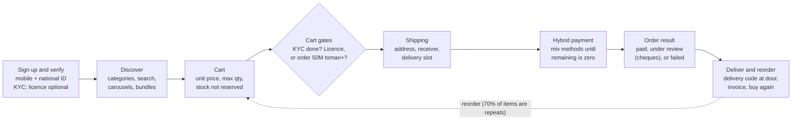

# B2R Foundation — Product & Design Knowledge Base

> **Knowledge-base copy.** Exported on 19 Oct 2026 from the living doc [B2R Foundation](https://claude.ai/code/artifact/22c93555-4a67-402f-bb4b-35bc1f20ed60), which stays the source of truth. Diagrams are converted to Mermaid or tables; status chips are plain text.

Oct 19, 2026 · @Panah

## How to use this doc

This is the reference a designer (or the AI design agent) reads before designing anything for B2R. It sits next to the [B2E Foundation](https://claude.ai/code/artifact/13b539f1-320f-440b-8c2f-9a635dfd6653) and covers only what is specific to B2R; layers both platforms share are linked there, not repeated here.

**Shared with B2E (read there):** the shared codebase and tenant model, design-system architecture and tokens, the shared component tiers, accessibility and responsive rules, the conflict-resolution process and the general decisions (no single source of truth, Bagisto → Supernova migration, current DS structure is not final, the design lead owns the DS libraries).

**Covered here:** what B2R is and who uses it, its domain rules, statuses, IA, flows, B2R-specific components and patterns, its own gaps and decisions.

**Sources and conflicts.** Same rules as the B2E doc: pick the source by question (strategy for the future, code and live for current behaviour, latest Figma for screens), never resolve a conflict silently, log it in Gaps with a status. The live FAQ is not used as a source.

**Tags.** **Current** = in code or live today. **Target** = in strategy or Figma, not built yet. **Gap** = a known inconsistency or missing piece.

## 1. Product context

**What B2R is.** B2R (business-to-retailer, formerly the CE platform) is the Digikala Business store at b2b.digikala.com. It sells consumer electronics (mobile, laptop, tablet, accessories, IT) at «نرخ همکار» (trade price) to shops, retailers and guilds (اصناف) across Iran. Buyers order single items, in bulk, or as ready-made bundles («سبدهای روز»). *Sources: Live; Confluence: B2B Product Platform Strategy.*

**Where it sits.** B2R was DKB's first specialist store. It shares one database and technical core with B2E, so payment, wallet and credit services are built once and used by both. Gold runs on a separate platform; Construction has none yet. *Source: Confluence: B2B Product Platform Strategy.*

**How it sells.** Three channels feed one storefront:

- **Self-serve online** (web, mobile-first).
- **Sales agents / telesales** («کارشناس فروش»): they verify customers and can build a cart with account-specific prices that the customer only pays. *Sources: Figma: Cart file ("assisted cart"); Live: club earn table.*
- **Field agents** (FieldOps) who visit shops to register and activate them. *Source: Confluence: FieldOps activation PRD.*

**Key numbers** (as stated in the sources; dates vary, treat as direction, not live KPIs):

| Metric | Value | Source |
| --- | --- | --- |
| Sales mix | Mobile 77% · IT 15% · Accessories 8% | Confluence: Cross-selling PRD |
| Activation (registered → first purchase) | 9.64% (2,017 of 20,931) | Confluence: Activation analysis |
| Drop-off right after registration | 70% | Confluence: Activation analysis |
| Activated users who buy in the first 2 weeks | 73% (first 24h is the strongest window) | Confluence: Activation analysis |
| Natural-person (حقیقی) share of customers | 97% | Confluence: Activation analysis |
| Average selling price | ≈ 21M toman | Confluence: Activation analysis |
| New registrants who reach shipping and buy | 24% (vs 78% for older users) | Confluence: Activation analysis |
| Repeat purchases | 70% of bought products (DKPs) are repeats; 68% of GMV | Confluence: Last purchases on home PRD |
| Platform conversion rate | ≈ 10% | Confluence: Segment-based carousels PRD |
| Field registrations | 4,790 / month, 20% activation, median 23 days to first purchase | Confluence: FieldOps activation PRD |

**What the business is pushing for.**

- **Activation:** turn registrations into a first order inside the 2-week window.
- **Repeat and depth:** faster reorder, cross-sell (accessories with phones), loyalty.
- **Credit as working capital:** a revolving credit line for verified shops. *Source: Confluence: CE Revolving Credit Strategy.*
- **Platform direction (Target):** a *Federated B2B Platform*. B2R becomes the **Retailer Commerce Mode** on a shared core (identity, catalog, search, cart, order, payment, credit, invoice, delivery, support), next to B2E's Organizational Procurement Mode. The strategy names the B2B depth still missing: MOQ, bulk pricing, reorder, loyalty, credit and cross-sell. This is a draft hypothesis to validate, not a final decision. *Source: Confluence: B2B Product Platform Strategy (Draft).*

## 2. Users & personas

No formal persona research was found in the sources. The personas below are **built from data** (activation analysis, PRDs, live account types, code) and should be validated with research. *Tag: Gap — see Gaps #1.*

**Who the customer is.** A business, not a person shopping for themselves. Two account types *(Current — Code: User/PersonType; Live)*:

- **حساب حقیقی (individual)** — "official invoice in a person's name", badge "for individuals and shops". About 97% of customers.
- **حساب حقوقی (legal entity)** — "official invoice in the company's name", badge "for companies". Needs company documents; approval took about 31 hours on average.

Customers also sit in a **customer group**. New users stay in the *General* group until telesales verifies them, which limits what they can buy. *Source: Confluence: Activation analysis.*

### Personas (hypothesis)

| Persona | Who | Main jobs | Main pains | Evidence |
| --- | --- | --- | --- | --- |
| **Mobile shop owner** (core) | Small phone or accessory shop, buys every week, mostly on a phone | Restock fast-moving phones; find the best margin today; reorder what sold | Daily price swings; stock runs out between cart and payment; business-licence rule blocks small orders | Mobile = 77% of sales; 70% repeat items; "best margin" and "suits your shop" carousels in Figma |
| **IT / laptop reseller** | Computer shop or IT dealer, higher order value | Bulk orders, cheque or credit payment, official invoice with economic code | Online payment cap (200M toman); cheque paperwork; invoice timing | IT = 15% of sales; IPG cap; cheque flows in Figma |
| **New registrant** | Any shop in the first 2 weeks | Explore prices and brands, place a first trial order | KYC and licence blocks at cart; unsure about address; wallet top-up confusing | Activation analysis: 70% drop, address modal 6×, wallet drop |
| **Company buyer** (legal) | Company buying for resale or own use | Official invoice in the company name; pay by transfer or cheque | Document approval delay; blocked at cart while pending | Activation analysis (legal pending = fully blocked) |
| **Instalment reseller** (Target) | Shop that sells to its own customers on instalments | Upload a customer list, get them credit-checked, order on their behalf with a margin | — (not live) | Figma: C-Credit flow; Code: DropShip module; live route returns 404 |

*Update (Drive research):* interviews and CSAT confirm the mobile-shop and reseller profiles and add one: **the market watcher**, who visits the PLP mainly to compare prices across 2–3 sources. See section 14.

### Internal actors who touch the journey

- **Sales agent / telesales** — verifies customers, builds assisted carts with set prices, sells by phone (points are also earned on agent sales).
- **Field agent** — visits shops, registers and activates them (registration, activation and repurchase visits).
- **Operations / finance** — approves KYC documents, reviews cheques, manages credit lines and repayments.
- **Content / growth admin** — sets home sections, carousels, bundles, campaigns and discount codes (dynamic home is Target).

*Sources: Confluence: FieldOps activation PRD, Dynamic homepage PRD, Revolving Credit PRD; Live: club earn table; Figma: Cart file.*

## 3. Domain model & business rules

### Main objects

- **Customer** — individual or legal; has KYC documents, an optional business licence (پروانه/جواز کسب), an optional economic code (کد اقتصادی), a customer group, addresses, a wallet, a loyalty tier, and optionally a credit line and cheques.
- **Product (DKP) and variant (DKPC)** — a variant is colour + guarantee (+ seller); price is per unit.
- **Category, brand, carousel, promoter section, bundle (سبد)** — the merchandising layer.
- **Cart → Order** — an order has a number and a DKO code, an orderer and a receiver, a delivery slot and one or more payments.
- **Payment** — one order can be paid with several methods (hybrid). Each method leaves a **transaction**.
- **Cheque, credit line, wallet, loan** — the money objects behind payment.
- **RFQ request and quote** — a buyer asks for an item or price; sellers answer with offers.
- **Loyalty** — points, monthly tier, rewards.
- **Campaign, discount code, gift card** — promotions.

### Rules

| Area | Rule | Tag | Source |
| --- | --- | --- | --- |
| Registration | One account per mobile + national ID. Individual: mobile, national ID, birth date. Legal: representative first, then company national ID and official gazette documents. An individual can't re-register as legal (and the reverse). | Current | Confluence: B2B User Operation PRD; Code: register errors |
| Verification | KYC must be complete before an order can be placed; while documents are under review the cart is blocked. | Current | Figma: Cart file; Confluence: Activation analysis |
| Business licence | Optional. Without it, **every order must be at least 50M toman**. Uploading it also earns loyalty points. | Current | Live: personal info; Figma: Cart file |
| Economic code | Optional. With it, invoices go to the tax system (سامانه مودیان) as a type-1 (business) customer. | Current | Live: personal info |
| Minimum order | A platform-wide minimum order amount exists as a config. Its relation to the 50M licence rule is unclear. | Gap #21 | Code: core-configs |
| Price | Trade price; all prices include 10% VAT; the unit price is shown on each cart line; some items show a small % discount with a struck price. | Current | Live; Figma: Cart file |
| Quantity | Each line has a maximum quantity («حداکثر»); low stock shows «تنها N عدد». MOQ and tier (bulk) pricing do not exist yet. | Current / Target | Code: Products; Confluence: Platform Strategy |
| Stock | Stock is not reserved in the cart. If an item runs out before payment it is removed and the total updates; if stock drops, the quantity is reduced with an alert (e.g. 15 → 8). | Current | Figma: Cart file; Live: cart |
| Delivery | Free. Tehran & Alborz: same day; other provinces: next day. Figma also shows a 15:00 cut-off and a "2-day" variant. Code knows jet, normal and post. Handover needs a delivery code and national ID. | Current, Gap #5 | Live: PLP/home banner; Figma: Cart, Hybrid payment; Code: delivery-methods |
| Payment | One order can be split across methods until «باقی‌مانده پرداخت» is zero. Online payment (IPG) is capped at **200M toman** per payment. | Current | Code: Payment/methods; Figma: Hybrid payment B2B |
| Payment methods | DKB credit, wallet, online gateway (SEP, Parsian), Sayadi cheque, bank transfer (sheba / account number / deposit ID), Eghtesad Novin bank loan, Digipay (credit, 4 instalments, wallet), Mehrad wallet, gift card, discount code. | Current (partly Target) | Code: methods, transaction titles; Figma: Hybrid payment B2B |
| Cheques in payment | Cheque amounts are allocated per order; if a discount code is added after cheques, the cheque amounts must be re-entered. An order paid with cheques under review stays "payment under review" until ops approves. | Current (design) | Figma: Hybrid payment B2B |
| Credit (current offer) | Up to 200M toman (100M and 200M now; up to 1B "coming soon"). Instant scoring (< 1 min), then one purple Sayadi cheque secures a 6-month line. Repay within 7 days with no fee; a late penalty applies after. Repaying restores the limit. | Current, Gap #3 | Live: /credit; Code: Credit module |
| Credit (target) | Revolving working-capital credit for verified shops: whitelist rollout, bank scoring via OTP for individuals, national-ID check for legal, repayment by transfer or wallet, credit T&C at request. | Target | Confluence: Revolving Credit Strategy + PRD Phase 1 |
| Wallet | Top-up online (instant) or by bank deposit; presets 50/100/200/400M toman. Used as a payment method. | Current | Live: wallet |
| Invoice | Official invoice is downloadable from order details — copy says "after payment" in one place and "after full delivery" in another. | Gap #4 | Figma: Cart file |
| Loyalty (بیزینس کلاب) | Points are earned each month; **this month's tier comes from last month's points**. Rewards are discount codes (2M–20M toman by tier) plus a lottery chance. Figma: a cart must be at least 10M toman to earn points. | Current, Gap #2, #22 | Live: /club, /profile/club; Figma: Cart file |
| First order | Code «welcome1» gives 1% off the whole first order, entered at the last step. | Current | Live: home; Figma: Homepage V2 |
| Bundles (سبدهای روز) | Daily curated bundles with labels (best seller, best value, "only in this bundle", sold out). Some bundles carry loyalty points. | Current | Live: /basket; Code: NewHome labels |
| Assisted cart | A sales agent can build a cart with prices set for that account; the customer reviews and pays. | Current (design) | Figma: Cart file |
| RFQ | For a missing item: item, quantity, optional target price and details → notified when supplied; or a multi-product price request that returns offers to compare. | Current | Live: /rfq; Code: RFQ |
| E-contract | Read and accept a contract before ordering or taking credit; acceptance is logged and can expire. | Target | Confluence: E-Contract PRD |
| Instalment resale (C-Credit; code name drop-ship) | Shop uploads its customers (Excel), they are credit-checked within 48h, then the shop orders for a chosen customer with an editable margin (purchase price → margin → instalment price). The customer confirms with an OTP sent to their own phone. If the order is larger than the customer's credit, the shop pays the rest (wallet, online, cheque, transfer). Access is granted per shop. | Target (built, not live) | Code: DropShip; Figma: B2R Platform - C-Credit; Live: 404 |

## 4. Status dictionaries

All from code (`apps/website`) unless marked otherwise. Use these keys and labels when designing badges, tabs and filters. Colours today are partly hard-coded (see Design system).

### Order

| Key | Label (UI) | Shown where | Note |
| --- | --- | --- | --- |
| pending | در حال بررسی | Orders tabs, profile summary |  |
| processing | در حال انجام / در حال پردازش | Orders tabs / profile summary | Two labels for one state — Gap #7 |
| completed | تحویل شده | All |  |
| canceled | لغو شده | All |  |
| ongoing | سفارش جاری | New home orders widget | Grouping, not a backend state |
| pending\_payment, closed, fraud | — | Not shown | Backend states with no UI label — Gap #7 |
| (design only) | جاری · در انتظار پرداخت · مرجوع شده · خریدهای سفارشی | Figma: Loyalty and Profile files (profile orders widget) | Adds awaiting payment, returned and custom (RFQ) purchases; not in code — Gap #7 |

### Payment result (checkout)

Success «پرداخت با موفقیت انجام شد» · Under review «پرداخت در حال بررسی است» (cheques waiting for approval) · Failed «پرداخت ناموفق» → «پرداخت مجدد». *Source: Figma: Hybrid payment B2B.*

### Cheque

| Key | Label | Meaning |
| --- | --- | --- |
| (default / new) | درحال بررسی | Submitted, being checked |
| approved | در انتظار تحویل چک | Approved; physical cheque not yet received |
| physical\_received | در انتظار سررسید | Paper cheque received; waiting for due date |
| deposited | پردازش بانکی | Sent to the bank |
| passed | پاس شده | Cleared |
| rejected, returned | رد شده | Refused |
| bounced | برگشت خورده | Bounced at the bank |

Profile cheque summary (live): remaining credit ceiling · credit ceiling · awaiting settlement; tabs open cheques / archive. Cheques can be extended (route exists).

### Verification documents (KYC, licence)

pending «درحال بررسی» · verified «تایید شده» · rejected «تایید نشده». Profile header shows «احراز هویت شده» when verified.

### Credit

| Object | States |
| --- | --- |
| Credit wallet | active · suspended «مسدود» (contact support) · closed «بسته شده» |
| Repayments (tabs) | due today · upcoming · paid; a discarded repayment can be retried for 14 days |
| Bank loan request (Eghtesad Novin) | success · failure |

### RFQ

| Object | Key → label |
| --- | --- |
| Request | New → جدید · Pending → در حال بررسی · Confirmed → پایان یافته |
| Quote / thread | New → پیشنهاد جدید · Answered → پیام‌های فروشنده · Pending → پیام‌های من · Approved → تایید شده · Rejected → رد شده |

### Transactions (wallet & payments history)

Categories: charges «افزایش موجودی» · refunds «بازگشت وجه» · cashouts «برداشت موجودی» · orders «خرید کالا» · installments «پرداخت اقساط». Status: accepted «موفق» · pending «در حال بررسی» · rejected «ناموفق».

### Loyalty

Tiers (live): پایه 0–35 · برنز 36–200 · نقره 201–800 · طلا 801–3,000 · زمرد 3,001–7,000 · الماس 7,001+ points. Reward states: available · redeemed · used · expired · rejected · pending. Points: current · unlocked · locked.

### Cart and bundle flags

Cart line errors: out-of-stock · cart-error · inactive. Bundle labels: sold out «تمام شد» · best value · only in this bundle · best seller.

## 5. Information architecture & navigation

### Global navigation (Current — Live)

- **Desktop header:** logo · «دسته‌بندی‌ها» mega menu · search «جستجو در دیجی‌کالا بیزینس» · login or profile menu · cart.
- **Mobile bottom nav (5):** خانه · دسته‌بندی‌ها · سبد خرید · سفارش‌ها · حساب کاربری.
- **Profile menu (live):** خلاصه فعالیت‌ها · سفارش‌های من · تاریخچه تراکنش‌ها · درخواست‌های خرید · آدرس‌ها · اطلاعات کاربر · تماس با ما · خروج. Above it, a profile card: account type, verified badge, "upload business licence" CTA, loyalty tier and this month's points, wallet balance with top-up, and "get purchase credit".
- **Code menu adds** «مدیریت چک ها» and «مدیریت API», which are not in the live menu (cheques page works by URL; API page returns 404). *Gap #10, #11.*

### Route map (Code: `apps/website/app`)

| Area | Routes | Status |
| --- | --- | --- |
| Discovery | / · /categories · /categories/selection · /products/\[category\] · /products/special · /plp/\[id\] · /pdp/\[id\] · /search · /carousel/\[id\] · /basket (daily bundles) | Current |
| Promotions | /campaign · /campaign/discount · /landing/gold-ce · /landing/hot-summer | Current (seasonal) |
| Checkout | /checkout/cart (also a cart drawer on any page) → /shipping → /payment · /preinvoice · /repayment · /thank-you · Digipay gateway and thank-you | Current |
| Account | /profile · orders, order detail, invoice · transaction · rfq, rfq/\[quote\] · addresses · personal-info · wallet (cash-in, receipt) · cheques, cheque detail, extend · credit, receipt, Eghtesad Novin · club | Current (cheques hidden) |
| Programs | /club (loyalty landing) · /loyalty · /credit (credit landing) · /rfq (price request) | Current |
| Partner channel | /komiteh-emdad (own layout, custom price, cart, pay, thank-you) | Unclear — Gap #11 |
| Instalment resale | /drop-ship/\* — a full mirror: products, search, categories, RFQ, checkout, profile with instalments | Built, not live (404) |
| Developer | /profile/api-management | Built, not live (404) |
| Static | /page/terms · privacy · contract · terms-and-condition · /login | Current |

### Home page (Current — Live)

Top to bottom: category grid (16 categories + "see all") · delivery promise hero · first-purchase discount promo · value strip (single & bulk ordering, free fast delivery, payment options, trade price) · «سور پرایس» carousel (orange band) · themed carousels (e.g. «سودِ اخرِ ماه IT») · FAQ · footer.

### Home page (Target — Figma Homepage V2 + PRDs)

- **Fixed:** header, categories, FAQ, footer, loyalty widget.
- **Personal (logged in):** left widget with current and delivered orders, invoice download; «خرید‌های قبلی شما» / «پرتکرارترین خریدهای شما» (last purchases, buy again).
- **Dynamic, admin-ordered:** value proposition, carousels, bundles, best sellers, one promoter section.
- **Segment / automatic carousels:** most-demanded this week, most profitable, best price in market, recently viewed, suits your shop, growing products, best margin for you.
- **Guest variants:** two guest types plus a sign-up nudge with the first-order code.

*Sources: Figma: CE Homepage V2 › UI Design V2.0; Confluence: Dynamic homepage, Auto recommendation, Last purchases, Segment carousels, Dynamic promoters PRDs. Which home is live (old Home vs NewHome module) is Gap #19.*

## 6. Core user flows

*Diagram: main B2R path and where shops drop off (from the Confluence activation analysis): 70% leave after sign-up · blocked at cart gates → sent to profile, about 50% drop before shipping · new users: 76% drop at shipping · wallet top-up detour at payment loses users.*

The path itself is simple; the losses come from the gates (verification and the 50M toman licence rule) and from uncertainty at shipping and payment. *Sources: Live; Figma: Cart file, Hybrid payment B2B; Confluence: Activation analysis.*

### 6.1 Onboarding & activation (Current)

Login with mobile + OTP → choose individual or legal → identity data (legal: representative, then company and documents) → browse. Verification runs in the background; a legal account waits about 31h. Today the cart is the first place a user learns they are blocked, and fixing it sends them away to the profile (licence upload) or back to auth pages. Figma Cart v2 moves the licence upload into the cart. *Target:* first-order code, guided first purchase inside the 2-week window, field-agent follow-up.

### 6.2 Browse & buy (Current)

Home or category → PLP (brand chips, filters, sort: most relevant / best selling / most / least expensive) → pick variant (colour + guarantee) and quantity in the list row, no need to open the PDP → cart drawer or cart page → checkout. Out-of-stock items offer «درخواست تامین» (RFQ) instead of add to cart.

### 6.3 Checkout & hybrid payment (Current)

Stepper: Cart › Shipping › Payment. Shipping: orderer and receiver, address, delivery slot. Payment: pick one or more methods and an amount for each — DKB credit, Sayadi cheques (choose existing or add new, set the amount used from each), wallet, bank loan, bank transfer, Digipay, online gateway (≤ 200M toman), plus discount code and gift card. The summary always shows total, discounts, paid so far and remaining. Result: paid · under review (cheques) · failed → pay again (/checkout/repayment).

### 6.4 Credit (Current)

/credit landing → instant scoring (< 1 min) → upload a photo of the filled purple Sayadi cheque → deliver or post the paper cheque → credit active → use it at payment → repay within 7 days (profile › credit: due today, upcoming, paid) → limit restored. Bank loan (Eghtesad Novin) has its own request flow. *Target:* revolving credit with whitelist and bank scoring (see Target capabilities).

### 6.5 Wallet top-up (Current)

Profile card or payment step → online (instant) or bank deposit with receipt → balance updates → use at payment. Leaving payment to top up is a known drop point for new users.

### 6.6 Loyalty (Current)

Earn points through the month (purchases, purchase days, KYC, licence) → tier for next month is set from this month's points → rewards (discount codes) appear in profile › club → redeem. Cart and checkout show "you'll earn N points".

### 6.7 Price request — RFQ (Current)

/rfq: add products by name → send → offers arrive in profile › purchase requests → compare, message, approve or reject. From a PLP row: request supply for an out-of-stock item with quantity and an optional target price.

### 6.8 Assisted purchase (Current, design)

Sales agent builds a cart with account-specific prices → customer sees «سبد خرید آماده پرداخت است» → reviews and pays online.

### 6.9 Reorder (Target)

Home shows last and most frequent purchases → one tap back to cart. Strategy also lists quick reorder, MOQ and bulk pricing as B2B depth to build.

### 6.10 Instalment resale — C-Credit (Target, designed and built, not live)

C-Credit entry in the header (login required) → upload customer list (Excel) → credit check within 48h → pick an approved customer → PLP in C-Credit mode shows instalment prices with the shop's default margin → adjust the margin per item in the variant modal → C-Credit cart «فروش اقساطی به …» with the customer's credit → payment: customer credit, plus another method if the order exceeds it → customer confirms with an OTP → order appears under «سفارش‌های فروش اقساطی». Shops without access see «امکان دسترسی به بخش فروش اقساطی برای شما وجود ندارد». \*Source: Figma: B2R Platform - C-Credit › Handoff.\*

## 7. Design principles for B2R

These sit on top of the shared principles in the B2E doc. Each comes from evidence above; they are proposals until the design lead confirms them.

1. **Price, stock and margin first.** A shop decides on today's price, availability and its own margin. Show unit price, VAT-inclusive totals, stock honesty ("only N left", "quantity reduced") and margin hints before anything decorative. *Evidence: trade-price value prop; "best margin" carousels; stock-change alerts.*
2. **Make the second order faster than the first.** 70% of items bought are repeats. Last purchases, buy-again, quantity entry in the list row and bundles beat browsing. *Evidence: Last purchases PRD.*
3. **Unblock where the user is.** Verification, licence upload, address and top-up should be solved inside the step that needs them, never by sending the user to the profile and hoping they come back. *Evidence: activation analysis (cart → profile 7×, wallet detour).*
4. **Money is always clear.** In any payment view the user sees total, what each method covers, what is left, and each method's limit (IPG 200M, credit remaining, cheque usable amount). No hidden recalculations: if a discount changes cheque amounts, say so and why. *Evidence: Hybrid payment B2B file.*
5. **Guide the new, step aside for the regular.** The first two weeks decide activation; new users need reassurance (delivery promise, official invoice, support) while regulars need speed. Design states for both. *Evidence: activation analysis; guest/registered home variants.*
6. **Trust through facts.** Official seller, guarantee name, official invoice, delivery promise and VAT are stated plainly and consistently in every place they appear. *Evidence: home FAQ topics; conflicting copy found (Gaps #4, #5, #6).*
7. **One journey, two drivers.** The same cart and order can be built by the shop or by a sales agent; both must read the same way and show who set the price. *Evidence: assisted cart; agent-earned points.*
8. **Mobile first, Persian first.** Most shops work on a phone. Design at 360 width first, RTL, Persian digits and toman formatting; desktop is the wider layout of the same thing. *Evidence: Figma mobile-first frames; bottom nav.*

## 8. Design system for B2R

The architecture (Figma *DS - Shadcn* with collections TailwindCSS · Theme · Mode · Custom, the code `@digikala/ui-kit`, IRANYekanX, 309 text styles) is shared and described in the B2E doc. As there: this is the **current setup, not the target**; it may be restructured. This section covers only what differs for B2R.

### Theme

| Item | Value | Source |
| --- | --- | --- |
| Figma theme mode | **CE** (the Theme collection has CE, Gold and B2E modes); to be renamed B2R — Decision D11 | Figma: DS - Shadcn |
| Primary | Navy ≈ #093672 (oklch 0.343 0.114 257.8) | Live CSS; Figma Theme › CE |
| How it is applied in code | B2R uses the **ui-kit default theme** (no tenant class on the page); B2E switches the theme by tenant | Live; Code |
| Surface | White background, light grey section bands | Live |
| Mode | Light only (dark mode "not yet" is a shared decision) | B2E decisions |

### B2R-only colour uses (Current)

- **Campaign bands:** «سور پرایس» uses an orange full-width band; seasonal landings (gold-ce, hot-summer) have their own look. None of these are tokens.
- **Loyalty tiers:** six colour ramps (`--loyalty-{tier}-100…700` for base, bronze, silver, gold, emerald, diamond) live only in the website app, not in Figma DS variables.
- **Status colours:** order, cheque and bundle badges use a mix of ui-kit tokens (`uiKit-success`, `uiKit-info`, `uiKit-warning`), legacy kit tokens (`kit-success-500`, `kit-accent-500`) and raw hex (#FEF2F2, #B91C1C, #4CAF50, #ED1944…).

### Drift (Gap #12)

The B2R app (`apps/website`) runs **three styling systems at once**: legacy `kit-*` classes from `mega-seeds`, `uiKit-*` classes from the new ui-kit, and inline hex values. The same meaning (e.g. "success") can render in three slightly different greens depending on the screen. Figma files for B2R (Homepage V2, Cart/Checkout, PLP V2) mostly use the DS - Shadcn library, so **Figma is closer to the target than the live app**. When designing: use DS variables only, and treat any hex seen in code as debt, not as a reference.

### Typography & formatting

IRANYekanX, RTL, Persian digits; money as toman with thousands separators (۴۴,۴۹۹,۰۰۰) and a toman sign or word; product titles are long, mixed Persian and Latin (model names) and must wrap to 2–3 lines. Some Figma files write money with the Arabic comma «،» and others with «٬» — see Content.

## 9. Components

Shared tiers (DS primitives → DS - Components → product components) are in the B2E doc. Below are the components **specific to B2R**, where they live and how mature they are. *Status:* **Stable** = in Figma and code and consistent · **Drift** = exists in both but differs · **Figma only** · **Code only**.

### Discovery

| Component | What it does | Figma | Code | Status |
| --- | --- | --- | --- | --- |
| Category grid / chips | 16 icon tiles on home; chip row on PLP | Homepage V2 | Home, Carousels/CategoryNavigationChips | Stable |
| Brand chips row | Logo chips to filter PLP by brand (most used filter) | PLP V2 | Products/CategoryBrandsCarousel | Stable |
| Delivery banner | Same-day / next-day free delivery promise | PLP V2 › Delivery Banner | Products/Banners | Drift (cut-off copy differs) |
| Filter & sort row | Side filters (price, brand, colour, storage, RAM…), sort | PLP V2 › Filter & Sort Row | Products/SideSection, SortV2 | Stable |
| Product row (list item) | Image, title, colour dots, price, variant picker «انتخاب رنگ», quantity, add | PLP V2 › DKP Card | Products/ListItemV2, ProductVariantV2 | Stable |
| Variant (DKPC) modal | Pick colour + guarantee + quantity; in C-Credit mode also edit margin | PLP V2 › DKPC Modal; C-Credit | Products/ProductVariantV2 | Stable / Figma only (C-Credit) |
| Quantity selector | Stepper with max cap «حداکثر» | PLP V2 › Quantity Selector | Products/QuantityComponentV2 | Stable |
| Product card (carousel) | Compact card for carousels and last purchases | Homepage V2 | NewHome/shared, best-seller | Stable |
| Bundle card «سبد» | Bundle number, item and model count, label, see details | Homepage V2, Cart file › basket-card v2.0 | NewHome/baskets, Basket | Drift (labels hard-coded colours) |
| Promoter section | One admin-chosen promo block with cards | Homepage V2 › Promoters | — | Figma only |
| Home left widget | Guest sign-up, or current/delivered orders + invoice | Homepage V2 | NewHome/Orders | Drift (states differ) |
| Out-of-stock RFQ action | «درخواست تامین» in place of add-to-cart + modal | PLP V2 › RFQ Modal | Products/RfqVariant, RFQ/PlpRfqModal | Stable |

### Cart, checkout, payment

| Component | What it does | Figma | Code | Status |
| --- | --- | --- | --- | --- |
| Cart line | Unit price, colour, guarantee, quantity, remove; OOS and reduced-stock states | Cart file › Cart v2.x | Checkout/Cart | Drift (3 Figma versions) |
| Cart alerts | OOS removed, stock reduced, KYC needed, under review, licence < 50M | Cart file | Checkout/Cart, shared/cart-errors | Drift |
| Licence upload in cart | Inline upload to unblock a sub-50M order | Cart file | — | Figma only |
| Order summary / bill box | Items, discounts, shipping, VAT note, payable, CTA | Cart file, Hybrid payment B2B › Checkout Bill-Box | Checkout | Stable |
| Checkout stepper | Cart › Shipping › Payment | Cart file | Checkout | Stable |
| Address & slot picker | Receiver, address, delivery time change | Cart file, C-Credit | Checkout/Shipping | Stable |
| Payment method item | One row per method with balance, limit, amount used | Hybrid payment B2B › Payments | Checkout/Payment/hybrid-payment (ui-kit strategy registry) | Drift (Figma ahead) |
| Cheque picker / cheque card | Choose or add Sayadi cheque, set usable amount, status badge | Hybrid payment B2B | Profile/cheques, Checkout/Payment | Drift |
| Discount code & gift card input | Apply, success, invalid states | Hybrid payment B2B | Checkout | Stable |
| Payment result screen | Success · under review · failed + next action | Hybrid payment B2B › Feedback Screen | checkout/thank-you, repayment | Stable |
| Cross-sell strip | «اکسسوری رو جا نذار» accessories in cart | Cart file | — | Figma only |
| OTP confirm (customer) | Customer approves a C-Credit order by code | C-Credit | DropShip | Not live |

### Account & programs

| Component | What it does | Figma | Code | Status |
| --- | --- | --- | --- | --- |
| Profile header card | Account type, verified state, licence CTA, tier, points, wallet, credit CTA | Profile, Loyalty files | Profile/shared | Drift (menu items differ) |
| KYB document uploader | Company docs (official gazette, introduction letter) with review/rejected + reason | Profile › KYB | User, Profile/personal-info | Drift |
| Status badges | Order, cheque, doc, RFQ, reward states | Various | Per module, hard-coded | Drift — Gap #12 |
| Loyalty tier badge & widget | Tier name, colour, points, points to next tier, days left | Loyalty › Tiers, Main Widget | Loyalty, shared/LoyaltyBadge | Stable (own colour ramps) |
| Loyalty cart / thank-you banner | "You'll earn N points" | Loyalty › Basket, Thank-you | Loyalty/CartLoyaltyBanner, PurchaseLoyaltyBanner | Stable |
| Reward row & modals | Coupon, credit increase, physical gift; copy code | Loyalty › reward row | Loyalty/reward | Stable |
| Credit landing blocks | Hero, limits, 3 steps, FAQ | None found yet | Credit/components | Code only |
| Wallet top-up | Online / bank deposit, preset amounts | Cart file › Wallet top-up | Profile/wallet | Stable |
| Transactions table | Filterable money history | — | Profile/transaction | Code only |
| Customers table (C-Credit) | Customers, national ID, credit, orders; Excel upload | C-Credit | DropShip/Profile/installments | Not live |

## 10. Patterns & content

### UX patterns to reuse

- **Act from the list.** Variant, quantity and add-to-cart live in the PLP row and the variant modal; the PDP is optional. Keep it that way for repeat buyers.
- **Honest stock.** Stock is not reserved: say so at cart, show "only N left", and when stock changes show what changed (old → new quantity), not just an error.
- **Gate with a fix.** Every blocking rule (KYC, licence, legal docs, credit access) shows the reason *and* the action in the same place: upload, re-upload with the rejection reason, or call sales.
- **Money ledger.** Any multi-method payment shows: total → each method's contribution → remaining. Each method states its own limit or balance. Changes that recalculate (discount after cheques) open an explanation, not a silent change.
- **Three-outcome result.** Every money action ends in success, under review or failed, each with one clear next step.
- **Earn hint.** Cart, checkout and thank-you show the loyalty points the order earns, or why it earns none (below 10M toman).
- **Two-driver cart.** A cart built by a sales agent is labelled as such and keeps its set prices.
- **Mode banner.** Special modes (C-Credit for a chosen customer) keep a visible banner with the customer and their credit so the shop never mixes orders.

### Writing & formatting

- Persian, polite plural (شما), short. Neutral «شما» only; do not address users as «همکار» (Decision D12).
- Money in **toman**, Persian digits, thousands separator. Figma mixes «،» and «٬», code uses «,»; one C-Credit frame shows rial. Use one format — Gap #17.
- Large amounts in copy: write "۲۰۰ میلیون تومان" rather than long digit strings.
- Dates in Jalali (e.g. ۲۵ مهر ۱۴۰۵، ۱۰:۳۷); delivery slots as weekday + date + hour range.
- Product titles are long and mixed-script; never truncate the model or storage part.

### Glossary (B2R)

| Term | Meaning | Note |
| --- | --- | --- |
| نرخ همکار | Trade price for businesses | Core value prop |
| سبدهای روز / سبد | Daily ready-made bundles | Native to B2R (in B2E it was decided a CE leftover) |
| سور پرایس | Surprise-price carousel | Campaign name |
| بیزینس کلاب | Loyalty programme | Spelled «بیزینس کلاب» and «بیزینس‌کلاب» |
| پروانه کسب / جواز کسب | Business licence | Two names for one document — Gap #8 |
| کد اقتصادی | Economic (tax) code | Drives official invoice type |
| روزنامه رسمی · معرفی‌نامه | Official gazette · introduction letter | Legal account documents |
| چک صیادی | Sayadi (registered) cheque | Also «چک مدت‌دار», «چک بانکی مدت دار» — Gap #17 |
| سقف اعتباری · حد اعتباری · اعتبار خرید | Credit ceiling / limit / purchase credit | B2E chose «حد اعتباری»; B2R uses all three — Gap #13 |
| اعتبار دیجی‌کالا بیزینس | DKB's own credit line | Spelled بیزینس and بیزنس |
| فروش اقساطی · C-Credit | Instalment resale to the shop's customers | Code name drop-ship |
| درخواست تامین · درخواست خرید · خرید سفارشی · پیشنهاد معامله | RFQ request, the list of requests, custom purchase, an offer | Four names for one feature — Gap #9 |
| کارشناس فروش | Sales agent | Assisted carts, phone sales |
| سفارش دهنده · تحویل گیرنده | Orderer · receiver | Can differ |
| کد تحویل | Delivery code | Shown at handover with national ID |

## 11. Target capabilities & roadmap

What B2R is moving towards, grouped by how far along each item is. Dates were not given in most sources, so this is an ordered list, not a schedule. *Stages:* **Built, not live** (in code, hidden) · **Designed** (Figma) · **Specified** (PRD) · **Strategy** (direction only).

### Activation & onboarding

| Capability | What | Stage | Source |
| --- | --- | --- | --- |
| Account sync with Supernova | One B2B identity across platforms; new registration rules for individual and legal | Specified | Confluence: B2B User Operation PRD |
| In-cart unblocking | Licence upload and KYC status inside the cart | Designed | Figma: Cart file |
| Legal KYB with re-upload | Company profile, document review, rejection reason, re-upload | Designed | Figma: Profile › KYB |
| E-contract | Accept a contract before ordering or credit; logged, with expiry | Specified | Confluence: E-Contract PRD |
| Field activation tools | Field agent visit types, call plans, legal registration in the field | Specified | Confluence: FieldOps PRDs |

### Discovery & reorder

| Capability | What | Stage | Source |
| --- | --- | --- | --- |
| Personal home | Last purchases, most frequent purchases, orders widget | Designed + Specified | Figma: Homepage V2; Confluence: Last purchases PRD |
| Dynamic home | Admin orders sections; one promoter section | Designed + Specified | Figma: Homepage V2; Confluence: Dynamic homepage, Dynamic promoters |
| Automatic & segment carousels | Weekly demand, best margin, suits your shop, time-bound segment campaigns | Specified | Confluence: Auto recommendation, Segment carousels |
| Search enhancement | Typo, transliteration and word-order tolerance | Specified | Confluence: Search enhancement PRD |
| Cross-sell | Accessory recommendations with phones (cart and PDP) | Designed + Specified | Figma: Cart file; Confluence: Cross-selling PRD |
| Wishlist | «علاقه‌مندی‌ها» in profile | Designed | Figma: Loyalty, Profile files |
| MOQ, bulk (tier) pricing, quick reorder | B2B depth features | Strategy | Confluence: Platform Strategy |

### Money

| Capability | What | Stage | Source |
| --- | --- | --- | --- |
| Full hybrid payment | Credit + cheques + wallet + loan + transfer + Digipay + IPG in one checkout; Gap 4 & 5 proposals (Sep 2026) | Designed, partly built | Figma: Hybrid payment B2B; Code: hybrid-payment |
| Cheque management in profile | Open and archived cheques, extend | Built, not in menu | Code; Figma: Profile |
| Revolving credit | Whitelist rollout, OTP bank scoring, repayment by transfer or wallet, credit T\&C; phases 2–3 | Specified | Confluence: Revolving Credit Strategy + PRD Phase 1 |
| Higher credit tier (up to 1B toman) | Shown as "coming soon" | Strategy | Live: /credit |
| C-Credit (instalment resale) | Shops sell to their customers on instalments with their own margin | Designed + Built, not live | Figma: C-Credit; Code: DropShip |
| Gold POS | POS service for gold shops | Specified (in progress) | Confluence: Gold POS |
| Informal sales | Accessories from selected suppliers, DKB not the seller | Specified | Confluence: Informal sales PRD |

### Loyalty & retention

| Capability | What | Stage | Source |
| --- | --- | --- | --- |
| Richer rewards | Credit-limit increase, physical gifts by phone, lottery, copyable codes | Designed, partly live | Figma: Loyalty › Handoff; Live: /club |
| Developer API | API keys / management for large resellers | Built, not live | Code: profile/api-management |

### Platform

| Capability | What | Stage | Source |
| --- | --- | --- | --- |
| Federated B2B Platform | B2R as Retailer Commerce Mode on a shared core with B2E; configurable behaviour per context (e.g. payment order) | Strategy (draft) | Confluence: Platform Strategy |
| Bagisto → Supernova | Backend migration (shared decision) | In progress | B2E doc decisions |

## 12. Gaps, inconsistencies & design debt

Nothing here is resolved silently. Each row says what conflicts, where we saw it, and why it matters for design. Status: **Open** → **Decided** (rule chosen, see Decisions) → **Fixed** (product updated).

| # | Gap | Evidence | Why it matters | Status |
| --- | --- | --- | --- | --- |
| 1 | No validated personas or recent user research for B2R | Personas here are built from data. Drive research adds interviews, CSAT and tests, but no readable persona study (Retailer Persona.fig is a backup file) | Design decisions rest on hypotheses | Open |
| 2 | Loyalty earn rules differ in three places | Live /club: licence 5, each 10M online 2, purchase day 2 (+ agent rules). Code: licence 2, day 5, 10M 3. Figma: also "each 5M". Tier ranges in code and Figma are placeholders | Users see different numbers in different screens | Decided |
| 3 | Credit offer and flags disagree | Live /credit is up; code flag `isCreditDeactive = true`; limits 100M/200M/1B toman live vs values in rial in code | Unclear what to design as current credit | Decided |
| 4 | Invoice timing copy conflicts | Figma: "after full delivery" vs "after payment and order" | Trust and support load | Decided |
| 5 | Delivery promise varies | Live: same day Tehran/Alborz, next day provinces. Figma: 15:00 cut-off and "2-day". Code: jet / normal / post | Core promise must be one sentence everywhere | Decided |
| 6 | Support hours differ | Live footer: Sat–Thu 8–17. Figma footers: 24/7 | Trust | Decided |
| 7 | Order statuses differ by screen | Orders page "در حال انجام", summary "در حال پردازش", home "سفارش جاری"; backend has 7 states, UI 4; Figma adds awaiting payment, returned, custom purchases | Status badges can't be designed consistently | Decided |
| 8 | Two names for the business licence | پروانه کسب (live profile) vs جواز کسب (cart, club, Figma) | Users may think they are two documents | Decided |
| 9 | RFQ has four names | درخواست تامین · درخواست خرید · خرید سفارشی · سفارشی قیمت بگیرید | Findability and IA | Decided |
| 10 | Cheque management hidden | Page works by URL and is in Figma and code menus, not in live menu | Users who pay by cheque can't find their cheques | Open |
| 11 | Built features with unclear status | C-Credit (/drop-ship) and API management return 404; Komiteh Emdad channel exists in code | Unknown whether to design for them now | Open |
| 12 | Three styling systems in one app | `kit-*`, `uiKit-*` and raw hex; status colours hard-coded; loyalty colours outside DS | Visual inconsistency; no single source for tokens | Open |
| 13 | Credit wording | سقف اعتباری · حد اعتباری · اعتبار خرید; B2E decided «حد اعتباری» | Shared core needs one term | Decided |
| 14 | Blocking rules are discovered late | Cart is the first place users learn about KYC or the 50M licence rule; fixing it leaves the cart | Main activation loss (about 50% before shipping) | Open |
| 15 | Address step causes doubt | New users open "add address" 6× and "edit address" 2× more than others; only 24% buy after reaching shipping | Second biggest loss for new users | Open |
| 16 | Wallet top-up is a detour from payment | New users who go to wallet rarely return (heuristic WAL-01: 65% never come back); a React error was also reported at payment | Lost orders at the last step | Open |
| 17 | Money and method naming not consistent | Separators «،» / «٬» / «,»; rial in one C-Credit frame; two cheque names; two gateway rows with the same title | Errors in reading amounts | Open |
| 18 | Figma B2R files are scattered and versioned | Cart v2.0 / 2.1 / 2.2 + "Cart Production"; PLP Handoff page is empty; cart/checkout file "not updated" | Hard to know the final design | Open |
| 19 | Which home is live is unclear | Code has both Home and NewHome; live home does not show the orders widget or last purchases | Designers may extend the wrong version | Decided |
| 20 | Placeholder reward text in code and Figma | Loyalty reward lists contain sample text that is not a real offer | Risk of shipping placeholder copy | Decided |
| 21 | Minimum order rule unclear | A platform minimum-order config exists beside the 50M licence rule | Can't design the right error | Open |
| 22 | Points threshold not explained | Figma: cart must be 10M toman+ to earn points; not on live club page | "I ordered but got no points" (a Figma FAQ) | Open |
| 23 | Stock is not truthful from PLP to payment | Heuristic CRT-01 (top score 36): items shown in stock vanish at checkout; interviews: colour shown available but not orderable, bundle-only stock, cancellations after payment; still in Jan 2026 CSAT comments | Biggest trust breaker; 42% of buyers who hit a stock or quantity error drop off | Open |
| 24 | «قیمت سفارشی» is not understood | PLP interviews (8 barrier mentions): users don't know whether to propose a price, wait for a call or get notified; heuristic review: use «ناموجود» instead | Requests stall; users read it as a hidden price | Open |
| 25 | Discount code apply is missed and errors lie | Tabriz event: users don't tap «+» to apply; when an item goes out of stock the error says «کد تخفیف نامعتبر است» | One of the most frequent questions at the event | Open |
| 26 | Payment page has no order summary | Heuristic CHK-01 (score 24): about 73% go back to check the order, 12% of those abandon | Lost orders at the last step | Open |
| 27 | Quantity control is slow and capped by surprise | Heuristic CRT-02/03/04: "+" passes the max then snaps back; about 5 s per tap; no typed quantity for bulk | B2B baskets are growing (2.7 → 3.9 items per order) | Open |
| 28 | Product modal is slow and loses input | Heuristic PDP-01/03/04: no skeleton, closing it wipes inputs, can submit without required fields; Tabriz: visible waiting | It is the only way to add to cart | Open |
| 29 | Handover needs the profile owner's national ID | PLP interviews: partner-run shops miss deliveries (one bought 200M toman elsewhere); B2E research: accounts in the CEO's name | Shops and companies are teams, not one person | Open |
| 30 | Hybrid payment is not understood on first use | Usability test (Jan 2026, n=5): nobody saw methods can be combined; «انتخاب این چک» missed in 4 sessions; pay button shows the full total, not the gateway part | High-value orders depend on this flow | Open |
| 31 | Delivery performance differs from the promise | PLP interviews: 2–4 days instead of same/next day, mostly provinces; CSAT delivery 70–80%; Tabriz attendees were satisfied | Promise (Decision D7) must match reality per city | Open |
| 32 | Credit and cheque policy changes are not communicated | Check-in research (Tir 1404): cheques returned and credit blocked during the war; a credit expired and was never reactivated | Remembered as a betrayal; drives shops to competitors | Open |

## 13. Open questions & decisions

### Decisions that already apply (from the B2E doc, shared layers)

- There is no single source of truth: pick the source by question; conflicts are logged, never resolved silently.
- Backend is moving from Bagisto to Supernova (in progress).
- The current DS, UI kit and Figma structure are not final and may be revised.
- Dark mode: not yet.
- The design lead owns the DS libraries and approves token changes.
- Payment methods differ per tenant (B2R keeps its own set and order).

### B2R decisions (19 Oct 2026, design lead)

| # | Topic | Decision | Gaps |
| --- | --- | --- | --- |
| D1 | Loyalty rules | The live /club page is the source of truth for earn rules and tier ranges. Code constants and Figma placeholders get aligned to it. | #2, #20 |
| D2 | Credit | The /credit offer (100M–200M toman, one Sayadi cheque, 7-day fee-free repayment) is the current product. Revolving credit (PRD) is the target that will replace it. | #3 |
| D3 | Credit term | «حد اعتباری» everywhere in B2R, same as B2E. | #13 |
| D4 | Licence term | «پروانه کسب» everywhere. | #8 |
| D5 | Order statuses | Keep the current four: در حال بررسی · در حال پردازش · تحویل شده · لغو شده, with the same labels on every screen. «سفارش جاری» is only a home grouping. | #7 |
| D6 | RFQ name | «درخواست خرید» for both the out-of-stock request and the price request. | #9 |
| D7 | Delivery promise | Free; same day for Tehran & Alborz, next day for other provinces. | #5 |
| D8 | Support hours | Saturday to Thursday, 8 to 17. | #6 |
| D9 | Invoice | The official invoice is available after payment and order, in order details. | #4 |
| D10 | Home | Figma Homepage V2 is a reference only; the home needs a redesign before the next release. | #19 |
| D11 | Theme | Keep the navy primary; rename the Theme mode "CE" to "B2R". | — |
| D12 | Voice | Neutral «شما» only; do not address users as «همکار». | — |
| D13 | Research | No research round for now; personas stay hypotheses. | #1 stays open |

### Still open

1. **Hidden features:** C-Credit, cheque management, API management and the Komiteh Emdad channel — live, upcoming or on hold? No preference given yet. (Gaps #10, #11)
2. **Final cart and checkout design:** no frame is final; the Figma file needs cleanup first. (Gap #18)
3. **Money format and cheque method name** (Gap #17), **minimum-order rule** (Gap #21), **points threshold copy** (Gap #22).

*When a question is answered, it moves to a Decisions list here and the related gaps switch to Decided.*

## 14. Research insights (Drive)

Read on 19 Oct 2026 from the team's Google Drive folder *04\_Research & Insights* (read-only). The full extraction, with numbers and anonymized quotes, is in the Project file `claude/research-insights-drive.md`. Personal data was left out. Figma, FigJam and Slides backups (for example *Retailer Persona.fig*, *DKB Personalization.deck*, *Search Report.deck*, *Loyalty Research.jam*) can't be read from Drive; send their live Figma links to add them.

### Studies used

| Study | When | Method | What it tells design |
| --- | --- | --- | --- |
| PLP → checkout drop-off | Mehr 1404 | 34 phone interviews with PLP visitors who didn't reach shipping | The PLP is a **price and stock watch tool**: shops check 2–3+ sources daily; a gap of 150–200K toman loses the sale. Barriers: price 21, stock 19, delivery 13, «قیمت سفارشی» 8, UX 4, credit 2 |
| Business check-in (war impact) | Tir 1404 | 53 phone interviews with loyal shops | DKB is one of several channels. Shops left for better price, fuller stock, faster delivery and credit; cheques returned and credit blocked during the war are remembered |
| Tabriz event | Mehr 1404 | Field observation, \~94 attendees, \~20 talks | Users miss the «+» that applies a discount code; stock-outs show «کد تخفیف نامعتبر است»; slow modal; want 4–5 day settlement and a guarantee-cheque credit line; sales reps on WhatsApp compete with the platform |
| Heuristic evaluation | Jun–Sep 2025 | 4 evaluators, Nielsen heuristics, 6 flows | 55 issues (14 at severity 4); 36 sit in add-to-cart → checkout → payment → wallet. No fix recorded as done |
| Hybrid payment usability test | Jan 2026 | 5 internal staff, moderated | All completed, 4 of 5 hesitated; nobody saw that methods combine; cheque selection missed; pay button shows the full total |
| Product thumbnail test | Apr 2025 | 5 sales agents, 12 phones | Only 47% recognized; look-alike Samsung A-series confused → always show model names |
| Best-selling A/B test | Aug–Sep 2025 | 4×4 grid with direct add-to-cart vs 4×3 with modal | Add-to-cart +11.15%, conversion +20.51%, rolled out 100%; significance is weak, read it as a direction |
| CSAT 1404 (old, historical) | Farvardin–Azar 1404 | 1,723 respondents, 1–5 scale | Platform (self-serve) price 59%, variety 63%, delivery 80%; Reseller settlement 65%; human support 92–98% |
| Research plans | Apr–Nov 2025 | 9 plans | Activation, homepage test, loyalty, legal customers, gold; most have no results report in Drive |

### What this changes for B2R design

1. **Design the PLP for monitoring, then for buying.** Price, stock, delivery promise and warranty per row, fast to scan; a short path from checking to buying (quick add, typed quantity, saved lists).
2. **Stock must be truthful everywhere** (Gap #23). Variant-level stock before selection, bundle-only flagged, explicit change notices in cart, back-in-stock alerts.
3. **Every async step gives feedback within \~100 ms** (skeletons, optimistic cart). Slow modals and 5-second quantity taps are direct abandonment causes.
4. **Keep users in the flow.** Top-up, login and cheque entry open inline and return to the step; back returns to where the user came from.
5. **Show the decision data where the decision is made.** Persistent order summary through checkout; the pay button shows what is charged now; remaining amount is the main number in hybrid payment.
6. **Errors say the real cause and the next step** (out of stock, not "invalid code").
7. **Receiving is a team task.** Delivery code usable by any staff member or named receivers (Gap #29).
8. **Credit and settlement are product features.** Visible credit state (active, blocked, expired, how to renew) and proactive notices when policy changes (Gap #32).
9. **Add a human layer.** Chat with a sales expert and rep-sent offers, so the platform doesn't lose to WhatsApp.
10. **Thumbnails never identify a phone alone.** Always pair with model and variant text.

### Old CSAT segments (historical, not in use)

The 1404 CSAT reports split B2R customers into Platform (self-serve), Retailer (managed) and Reseller (company) channels. **These segments are no longer used** (design lead, 19 Oct 2026), so don't design for them. Treat the CSAT scores in this section as old signals about pain points, not as current KPIs.

Loyalty tiers in 2025 (from the loyalty research plan): Base 369 · Bronze 219 · Silver 71 · Gold 20 · Diamond 6.

### Conflicts with facts in this doc

- **Delivery:** interviews report 2–4 days in provinces against the same-day / next-day promise (Decision D7) — Gap #31.
- **97% natural persons:** many "individual" accounts are shared shops, partners or company buyers; don't assume one account = one person.
- **Credit:** credit and cheque buying were suspended after the war; confirm what the /credit offer (Decision D2) means for these users.
- **Activation:** the May 2025 plan implies about 2.7% (94 active of 3,454), against 9.64% in the later Confluence analysis — different periods and definitions.

## 15. Sources

All sources were read on 19 Oct 2026. Git access was read-only. Personal data seen in the test account was not recorded.

| Type | Source | Used for |
| --- | --- | --- |
| Live | [b2b.digikala.com](https://b2b.digikala.com) — logged out and logged in (individual, verified, base tier, no orders) | Current IA, copy, rules, statuses |
| Code | GitLab `b2b-shop-front` (develop) › `apps/website` — modules, routes, constants | Routes, statuses, payment methods, feature flags |
| Figma | [CE Homepage V2](https://www.figma.com/design/tOgOKXY5k9UOuSTl1e0y2I) › UI Design V2.0 | Home target, carousels, widgets |
| Figma | [Cart, Checkout & Order History](https://www.figma.com/design/0WGNUxcG6vsHYja8MXsbhp) › Cart, Hybrid payment B2B | Cart rules, hybrid payment, results |
| Figma | [PLP V2](https://www.figma.com/design/IUEquAFnRC7yCUX3zoMkXV) › Exploration | PLP components, RFQ modal |
| Figma | [Loyalty Program](https://www.figma.com/design/caOX7jmTuJvWw9pcebAV3G) › Handoff | Club profile, rewards, tiers, banners |
| Figma | [B2R Platform - C-Credit](https://www.figma.com/design/2JMEivE0r2z4cG95IeZhcc) › Handoff | Instalment resale flow |
| Figma | [Profile](https://www.figma.com/design/I4xq8drvDqIyhf3NFlDWt0) › Profile | KYB, profile header, menu |
| Figma | DS - Shadcn, DS - Components | Tokens and components (see B2E doc) |
| Confluence | [CE-Platform team space](https://docs.digikala.com/pages/viewpage.action?pageId=175881110) — PRDs: B2B User Operation, Cross-selling, E-Contract, FieldOps activation, Field call plan, Search enhancement, Gold POS, Informal sales, Auto recommendation, Last purchases on home, Dynamic homepage, Segment-based carousels, Dynamic promoters | Product context, target capabilities |
| Confluence | [Activation analysis](https://docs.digikala.com/pages/viewpage.action?pageId=180767803) | Funnel numbers, blockers |
| Confluence | [B2B Product Platform Strategy](https://docs.digikala.com/pages/viewpage.action?pageId=180774752) (draft) | Platform direction |
| Confluence | [CE Revolving Credit Strategy](https://docs.digikala.com/pages/viewpage.action?pageId=180776165) · [Revolving Credit PRD Phase 1](https://docs.digikala.com/pages/viewpage.action?pageId=191175753) · [CE Purchase Demand Evidence](https://docs.digikala.com/pages/viewpage.action?pageId=180774828) | Credit target |
| Doc | [B2E Foundation](https://claude.ai/code/artifact/13b539f1-320f-440b-8c2f-9a635dfd6653) | Shared layers and decisions |
| Research | Google Drive › 04\_Research & Insights (interviews, heuristic evaluation, usability and A/B tests, CSAT, research plans); digest in Project file claude/research-insights-drive.md | Section 14, personas, gaps #23–#32 |

Not used: the live FAQ (unreliable for now).
