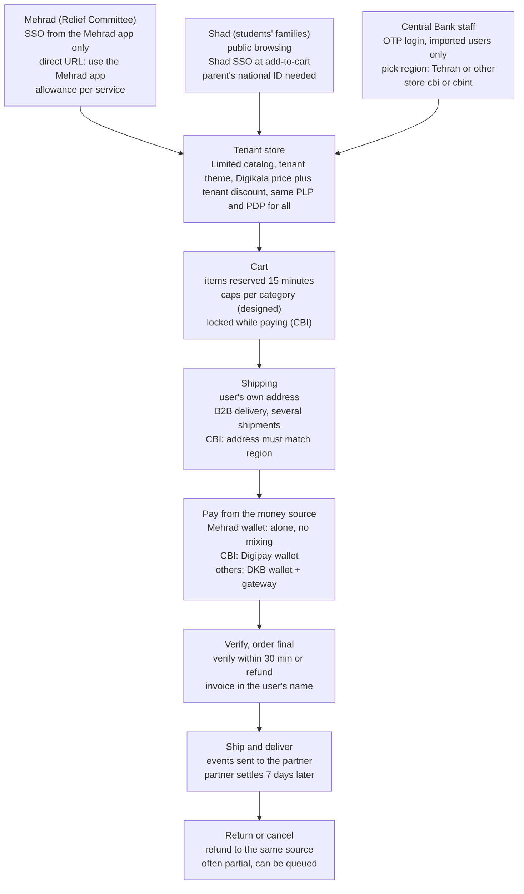

# Portals Foundation — Product & Design Knowledge Base

> **Knowledge-base copy.** Exported on 19 Oct 2026 from the living doc [Portals Foundation](https://claude.ai/code/artifact/f724da9d-8560-4490-b3e0-39aec7fea96a), which stays the source of truth. Diagrams are converted to Mermaid; status chips are plain text.

Oct 19, 2026 · @Panah

## How to use this doc

This is the reference a designer (or the AI design agent) reads before designing anything for **Enterprise Portals** — the dedicated stores where a company's staff, or another closed group, spend money their organization or a partner gave them, on a limited catalog. It sits next to the [B2E Foundation](https://claude.ai/code/artifact/13b539f1-320f-440b-8c2f-9a635dfd6653) and the [B2R Foundation](https://claude.ai/code/artifact/22c93555-4a67-402f-bb4b-35bc1f20ed60) and covers only what is specific to portals.

**Shared with the other docs (read there):** the shared codebase, design-system architecture and tokens, component tiers, accessibility and responsive rules, the conflict-resolution process and the general decisions (no single source of truth, Bagisto → Supernova migration, current DS structure is not final, the design lead owns the DS libraries, dark mode not yet).

**Covered here:** what portals are and the four live tenants, who uses them, the tenant model and feature flags, rules, statuses, flows, tenant theming, portal-specific components, gaps and decisions.

**Sources and conflicts.** Same rules as the other docs: pick the source by question (strategy for the future, code for current behaviour, latest Figma for screens), never resolve a conflict silently, log it in Gaps with a status. Portals are private (SSO or invited users), so they were **not walked live**; current behaviour comes from code (`apps/portal`, develop branch, read-only) and Confluence PRDs.

**Tags.** **Current** = in code today. **Target** = in strategy, PRD or Figma, not built yet. **Gap** = a known inconsistency or missing piece.

## 1. Product context

**What a portal is.** «پلتفرم خرید کارکنان سازمان» (staff purchase platform): an organization lets its staff, or another defined group, buy a **controlled set of Digikala products** with a **defined money source** (organization budget, a partner wallet, a welfare card) under the organization's rules. Two delivery models are planned: a **dedicated store** built by DKB (URL, logo, colours, catalog) or an **API** into the organization's own app. *Source: Confluence: Portal Domain and Proposal (Aug 2026).*

**Boundaries (Target, agreed direction).**

| Need | Owner |
| --- | --- |
| Full Digikala catalog, normal shopping | Digikala |
| Welfare services, travel, health, wide financial tools | Digipay |
| A company buying for its own needs (procurement, invoices, credit) | B2E |
| Staff or beneficiaries buying a limited catalog with an allowance | **Portal** |

The portal owns the catalog layer, purchase rules, ordering and delivery. It does **not** own or underwrite the money: the organization, the user or a funding partner carries the credit and default risk. *Source: Portal Domain and Proposal.*

**Pricing principle.** Base price is always Digikala's price. Organization-specific differences live in a separate layer: discount, cashback, coupon, catalog scope, spending cap and quantity rules.

**Live tenants (Current — code).**

| Tenant | Who | Money source | Catalog | Entry |
| --- | --- | --- | --- | --- |
| **مهراد · Imam Khomeini Relief Committee** (`/mehrad`) | Beneficiaries of the Relief Committee using the Mehrad super-app; \~100K users, 1,000 enabled in phase 1 | Mehrad wallet (allowance per service, e.g. groceries or dowry), plus DKB wallet and gateway | Home and kitchen appliances, bedding, TV; preselected items from listed sellers | SSO from the Mehrad app only |
| **شاد** (`/shad`) | Families of students using the Shad education app (30M+ MAU claimed) | DKB gateway and wallet only (Shad wallet later) | Toys, game consoles, digital, books and stationery, sport; up to 20K items | Public browsing; SSO when adding to cart |
| **Central Bank (CBI)** (`/cbi`, `/cbint`) | \~10,000 Central Bank staff; Tehran (`cbi`) and other regions (`cbint`) | Digipay wallet charged with 20M toman per person, no expiry | Supermarket / FMCG (DF category), up to 20K items | OTP login; users are pre-imported, no sign-up |

**Results so far (CBI, 28 Shahrivar – 11 Mehr 1405).** 2,858 Digipay payment attempts, 2,440 successful (85.4%); 1,851 unique buyers; 33.9B toman sold; average order 13.9M toman; 52% of purchases between 17:00 and 23:00. 863 orders had refunds (75% partial), and refunds could wait in a queue until the refund wallet was charged. *Source: Confluence: Digipay Wallet Report | CBI.*

**Before the portal.** The Relief Committee already bought through Digikala via whitelisted landing pages: about 4,000 orders a month worth 400B toman, \~5 items per order, \~300 active items. *Source: Mehrad PRD.*

**State of the product (honest view from the team).** The PRDs say the portal is **not yet a scalable product**: each tenant was built as a time-pressured, one-off customization (Mehrad SSO, Shad SSO, CBI region split), which makes adding new portals hard. The proposal's target is a configurable platform: a central console to create portals, an admin panel per organization, user lists, segments, allowances and reports. *Sources: Shad PRD; Portal Domain and Proposal.*

## 2. Users & roles

Portals serve **people buying for themselves** with money someone else gave them. The account is personal (invoice in the end user's name), but operations treat orders as **B2B** (DKB packaging, signed delivery receipt, B2B logistics). *Source: Mehrad, CBI and Shad PRDs.*

### End users by tenant (Current)

| Persona | Context | What they need | Watch out for |
| --- | --- | --- | --- |
| **Welfare beneficiary** (Mehrad) | Low-income family supported by the Relief Committee; arrives from the Mehrad app with a fixed allowance per service | Spend the allowance on essentials and household items, simply and safely | Low digital confidence; the allowance is split by service; cannot pay part with Mehrad and part with another method |
| **Parent of a student** (Shad) | Arrives from the Shad education app, often on a phone, nationwide | A safe, limited catalog suitable for children; school supplies in the back-to-school campaign | Students have no national ID of their own — only users with a parent's national ID can use it; delivery by post matters outside big cities |
| **Staff member** (CBI) | Central Bank employee with a 20M toman yearly welfare allowance in a Digipay wallet | Choose their own groceries instead of a fixed package; quick checkout during a short buying peak (\~2 days) | Must pick the right region (Tehran vs. other); refunds go back to the Digipay wallet slowly |

### Organization and operator roles (mostly Target)

From the proposal (no admin panel exists in code yet):

- **Organization decision-maker** — chooses the solution, controls cost, sees management reports.
- **Organization portal admin** (HR, welfare, procurement or finance) — manages users and segments, allowed catalog, allowances, delivery policy, reports; can add sub-admins and hand over the main admin role.
- **Funding partner** (bank, fintech, Digipay, partner app) — sees spending and refunds of its money; carries the risk.
- **DKB platform admin** — creates, suspends and archives portals, sets URL, branding, features, integrations.
- **DKB operations & logistics** — eligible sellers and warehouses, SLA, support, B2B handling of higher volume.

Today these jobs are done by DKB teams by hand: user lists are imported, catalogs are set up per channel, and financial reconciliation with Mehrad is manual. *Sources: Portal Domain and Proposal; Mehrad PRD; code.*

## 3. Domain model & business rules

### The tenant ("vertical") model — Current

One Next.js app (`apps/portal`) serves every portal. Each tenant is a **VerticalConfig** chosen by URL prefix:

- **Identity:** slug, basePath (`/mehrad`, `/shad`, `/cbi`, `/cbint`), login path, API channel (`b2e_mehrad`, `b2e_shad`, `b2e_cbi`, `b2e_cbint`), analytics event prefix.
- **Entry:** private or public; gateway type `external` (SSO code from the partner app) or `login` (own OTP login); the copy shown when entry fails.
- **Home content:** featured categories, hero slides, promo banners, "how to buy" steps.
- **Branding:** logo, favicon, title, primary colour, theme class, support phone.
- **21 feature flags** (table below).

The unprefixed root (old B2E) is no longer an entry point: any path without a tenant prefix is sent to `/failed-auth`. A cookie remembers the active tenant so a bank-gateway return without the prefix lands in the right store.

| Flag | mehrad | shad | cbi / cbint |
| --- | --- | --- | --- |
| isPrivate (must be signed in to see anything) | yes | **no** | yes |
| Entry | SSO from Mehrad app | SSO at add-to-cart | own OTP login |
| registrationEnabled | (on, unused) | (on, unused) | **off** — users imported |
| regionSelection | no | no | **yes** (Tehran / other) |
| categoriesHeader | no | yes | yes |
| logoutButton | no | no | yes |
| loginButton | no | no | no |
| coupon | yes | yes | yes |
| jetDelivery (same-day first) | no | no | no |
| awaitingPaymentOrders | no | no | **yes** |
| cartEditableCheck (locked cart) | no | no | **yes** |
| rfq, creditPage, loyaltyPage, KYC steps (person type, e-contract, company letter, geo) | off or unused | inherited from B2E, mostly unused | off |

### Rules

| Area | Rule | Tag | Source |
| --- | --- | --- | --- |
| Access | Only eligible users see the store. Mehrad: entry only from the Mehrad app; direct URL shows «برای ورود به این سامانه، از اپلیکیشن مهراد استفاده کنید». CBI: only the 10K imported numbers; others see «ورود به فروشگاه برای شما امکان‌پذیر نیست». Shad: anyone can browse; buying needs Shad SSO. | Current | Code; PRDs |
| Identity | Users are created just-in-time from the partner's data; standard KYC (Shahkar) is skipped (Mehrad, Shad) or done by the partner (CBI via Digipay). Partner data never overwrites existing Digikala data. | Current | Mehrad, Shad, CBI PRDs |
| Target login | The proposal makes **OTP login the default** for every portal; SSO only when standard, reusable and justified. | Target | Portal Domain and Proposal |
| Region (CBI) | After sign-in the user picks Tehran (22 districts) or other regions; this decides the store (cbi / cbint), channel and customer group. If the delivery address doesn't match, checkout warns: «آدرس انتخابی شما با موقعیت انتخابی هنگام ورود هماهنگ نیست». | Current | Code; Figma: CBI Location Select |
| Catalog | Each tenant sees only agreed categories/items, up to \~20K items. Mehrad maps each Mehrad service (groceries, dowry…) to Digikala categories by hard-coded mapping. Category tree is Digikala's, not customized. | Current | PRDs |
| Price | Digikala's selling price; a per-item discount % can be imported (Shad, CBI). CBI: one personal coupon per user up to 100K toman. | Current | Shad, CBI PRDs |
| Purchase caps | Designed: max 3 home-appliance items per cart and max 1 large appliance per cart, with an explanatory block on PDP. Target: caps by amount, quantity, category, segment, time window. | Target (designed) | Figma: Max order amount rules; Proposal |
| Cart reservation | Items are reserved for 15 minutes; an unpaid order shows a countdown and is cancelled when it ends. | Current (CBI) | Figma: Orders & Edge Cases; code (awaiting payment) |
| Locked cart | While an order made from the cart is being paid, the cart can't change; quantities freeze and the reason is shown. | Current (CBI) | Code |
| Payment | Mehrad wallet is a separate gateway-like method and **can't be combined** with others; DKB wallet + bank gateway (TOP) can be combined. CBI: Digipay wallet, not combinable with non-Digipay methods. Shad: DKB gateway and wallet only. | Current | Mehrad Wallet PRD; CBI PRD |
| Mehrad payment lifecycle | Create payment (rial) → redirect → callback → verify within 30 min (once, no retry) → order final; unverified payments are refunded to the Mehrad wallet. Ship and Deliver events are sent to Mehrad; Mehrad settles 7 days after delivery. | Current | Mehrad Integration Assessment; Mehrad Wallet PRD |
| Refunds | Full refund supported; partial refunds added later (about 30% of returns are partial). CBI: 75% of refunded orders were partial. | Current | Mehrad, CBI reports |
| Invoice | Tax-system invoice type 2 in the **end user's name**, not the organization's. | Current | Mehrad, Shad, CBI PRDs |
| Fulfilment | Retail stock from Danesh, Badamak and Shadabad warehouses; marketplace cross-dock/consignment allowed; seller-shipped (SBS) not supported in phase 1. Shipments follow Supernova suggestions (date, nature, warehouse). Delivery cost as for normal B2B orders. | Current | PRDs |
| Delivery models (Target) | To each user's address or to an organization hub with packages separated and labelled per person. | Target | Proposal |

## 4. Status dictionaries

From `apps/portal` unless marked. Portals have **more order states than B2R** because of the Supernova handoff, awaiting-payment orders and approvals.

### Order

| Key | Label | Meaning | Note |
| --- | --- | --- | --- |
| pending\_payment | در انتظار پرداخت | Saved, not paid; countdown to auto-cancel | CBI awaiting-payment flow |
| order\_approval | در انتظار تایید | Waiting for approval | Who approves isn't documented — Gap #6 |
| pending\_supernova | در حال ثبت نهایی | Being registered in Supernova; pay after a few minutes | «سفارش شما در حال ساخته شدن است…» |
| pending\_supernova\_confirmation | تایید ثبت نهایی | Registered |  |
| pending\_supernova\_cancellation | ثبت نهایی لغو شده | Registration cancelled |  |
| pending | در حال بررسی | Under review |  |
| processing | در حال انجام | Being prepared | B2R decided «در حال پردازش» — Gap #7 |
| completed | تحویل شده | Delivered |  |
| canceled | **رد شده** | Cancelled | B2R says «لغو شده»; tabs here also say «لغو شده» — Gap #7 |
| delivery\_canceled | لغو ارسال | Delivery cancelled |  |
| closed | بسته شده | Closed |  |
| fraud | رد شده | Rejected as fraud | Same label as canceled |

Order tabs: جاری · تحویل شده · لغو شده. Figma adds «مرجوع شده» and «لغو سیستمی», and a 3-step shipment timeline: درحال پردازش → خروج از انبار → ارسال برای مشتری / تحویل مرسوله به مشتری. *Source: Figma Portal › Orders & Edge Cases.*

### External wallet payment (Mehrad)

| Status | Meaning | Portal behaviour |
| --- | --- | --- |
| PENDING | User hasn't paid yet | Order stays awaiting payment |
| PAID | Paid, not verified | Verify within 30 minutes |
| VERIFY\_OK | Paid and verified | Order final (once) |
| VERIFY\_TIMEOUT | Not verified in time; money returned | Order not final → failed / cancelled |
| VERIFY\_FAILED | Verify failed | Payment failed |
| USER\_CANCELED / CANCELED | Cancelled by user / system | Not final; reason stored |
| MERCHANT\_CANCELED | Cancelled by DKB (delivery cancel, return) | Full refund |

Unknown result (network timeout): keep the order in Pending Payment and run a status job. *Source: Mehrad Wallet PRD.*

### Entry and access states

| State | Screen |
| --- | --- |
| Missing or bad SSO code | External-auth failed screen with the tenant's image, title, description and a home link to the partner app |
| Rejected code (expired / used) | Backend message shown inline |
| Number not on the organization's list | «این شماره موبایل از طرف {نام سازمان} برای ورود به پلتفرم تعریف نشده است…» (Figma) |
| No tenant prefix | Redirect to `/failed-auth` |
| Under construction | Maintenance page (flag) |

### Wallet / credit

Credit wallet: active · suspended «مسدود» · closed «بسته شده» (shared with B2R). Mehrad wallet component: active (balance ≥ payable) · disabled at zero balance · disabled with retry when the balance call fails.

## 5. Information architecture & navigation

### URL structure (Current)

Every page lives under the tenant prefix: `/{tenant}/…` (e.g. `/cbi/products/52`). The production domain isn't stated in the code or PRDs — Gap #12.

| Area | Routes |
| --- | --- |
| Entry | `/{tenant}` home · `/{tenant}/login` (cbi only) · `/{tenant}/failed-auth` |
| Discovery | home · `/products/[category]` · `/products/special` · `/plp/[id]` · `/pdp/[id]` · `/search` · `/carousel/[id]` · `/basket` (bundles) |
| Checkout | cart drawer `?cart=true` and `/checkout/cart` → `/checkout/shipping` → `/checkout/payment` (also `/checkout/cart/payment`) · `/checkout/order-payment?orderId=` (pay an awaiting order) · `/preinvoice` · `/repayment` · `/thank-you` |
| Account | `/profile` · orders, order detail, invoice, pre-invoice · addresses · personal info · wallet (cash-in, transactions, receipt) · credit, receipt · RFQ |
| Programs | `/rfq` · `/credit/eghtesad-novin` (landing, apply, thank-you) — mostly flagged off for portals |
| Static | `/page/terms` · `/page/privacy` · `/page/contract` |

### Navigation

- **Header:** tenant logo · search «در میان کالاها جستجو کنید» · categories mega menu (hidden for Mehrad) · profile · cart. No login button on any tenant (entry is SSO or the login page).
- **Mobile bottom nav:** خانه · دسته‌بندی · سبد خرید · سفارش‌ها · حساب کاربری (Figma).
- **Profile menu (code):** سفارش‌های من · آدرس‌ها · اطلاعات کاربر (+ خروج on CBI). Much simpler than B2R.
- **CBI region bar:** «موقعیت انتخابی شما: مناطق ۲۲ گانه شهری تهران» with «تغییر موقعیت».

### Home page (config-driven, Current)

Top to bottom, each block shown only when the tenant config has content: hero slides (desktop + mobile images) · featured categories grid · carousels (best sellers etc.) · promo banners · "how to buy in 3 steps" (جستجو و انتخاب → پرداخت و نهایی کردن سفارش → تحویل گرفتن محصولات) · FAQ · footer. Logged-in users also see current orders.

### Target IA (Proposal)

Three surfaces instead of one: **user store** (as today), **organization admin panel** (users, segments, catalog, allowances, delivery policy, orders, reports, audit log) and **DKB platform console** (create / suspend portals, templates, integrations, branding).

## 6. Core user flows

*Diagram: three ways in, one shared store and checkout. Entry and payment are tenant-specific; everything between is shared.*

Entry and payment are where tenants differ; everything between them is shared. *Sources: code; Mehrad, Shad, CBI PRDs; Mehrad Wallet PRD; Figma Portal.*

### 6.1 Mehrad (Current)

Open the Mehrad app → «خرید از دیجی‌کالا» → Mehrad sends an authorization code to the DKB callback → the portal exchanges it for a session (user created just-in-time) → home with Mehrad categories → browse and add to cart → shipping → payment page shows the **Mehrad wallet balance** first, then DKB wallet and gateway → choose Mehrad wallet → redirect to Mehrad → return → DKB verifies → order final. Entering by URL shows the "use the Mehrad app" screen with a link back to the app. Access tokens last 12 hours with no refresh: the user re-enters from the app.

### 6.2 Shad (Current)

Open the store from the Shad app; the one-time SSO values are saved on arrival → browse publicly → on **add to cart** the portal exchanges the SSO values for a session → cart → shipping (post matters nationwide) → pay with DKB gateway or wallet. Only users with a national ID on file (the parent's) can buy.

### 6.3 Central Bank (Current)

Open the CBI link → `/cbi/login` → enter mobile → OTP → if the number isn't imported, "you can't enter this store" → choose region (Tehran 22 districts or other) → store `cbi` or `cbint` → add groceries → cart (items held 15 minutes) → shipping (address must match the region) → pay from the **Digipay wallet** (20M toman allowance) → order. If payment isn't finished, the order stays in «در انتظار پرداخت» with a countdown on the cart page and the pay link `/checkout/order-payment`; the cart stays locked meanwhile.

### 6.4 After purchase (all)

Orders list (current / delivered / cancelled) → order detail with shipments, delivery slot, delivery code, payment history, invoice → «خرید مجدد کالاهای سفارش» (Figma) → return or cancellation → refund to the original money source.

### 6.5 Organization admin (Target)

Create the portal from a template → upload or sync the user list → define segments → choose allowed categories, products or variants per segment → set allowance and caps → choose delivery model (personal address or hub) → monitor orders, spending and refunds → export reports. *Source: Portal Domain and Proposal.*

## 7. Design principles for portals

Proposals derived from the sources; confirm with the design lead.

1. **One product, many skins.** Search, PDP, cart, checkout, tracking and returns are the same for every organization. Customization lives only in two layers: look (logo, colour, name, URL, banners) and rules (catalog, allowance, caps, delivery). Never design a one-off flow for a tenant. *Evidence: proposal §8; team warning in Shad PRD.*
2. **The allowance is the hero.** Users come to spend money someone gave them. Show the available balance (per service when split), what it covers, and what remains, before and during checkout.
3. **Only show what can be bought.** The catalog, filters, search suggestions and carousels must never show items outside the tenant's scope or above a cap; explain caps before the user hits them ("max 1 large appliance per cart").
4. **Entry must never feel like a dead end.** Every access failure says why and where to go (the partner app, the organization's contact), in the tenant's voice and identity.
5. **Simple for low-confidence users.** Beneficiaries and families may be new to online shopping: big touch targets, few steps ("buy in 3 steps"), plain words, clear delivery and return promises.
6. **The partner's identity, DKB's trust.** The store should feel like "my organization's store" while making clear that Digikala delivers and guarantees.
7. **Money goes back where it came from.** Refund and cancellation states must say which wallet gets the money and when, especially when refunds are queued.
8. **Design for peaks.** Allowance programmes create short, intense buying windows (CBI: most buying in about 2 days, 52% in the evening): fast pages, honest stock, reservation timers.

## 8. Design system: tenant theming

> **For new designs, use the DKB Design System** (v0.3, Oct 2026; details in the B2E doc and the Project-X repo `design-system/`). A tenant is **one extra mode of the `brand` collection**, made from a single hex with `scripts/make_ramp.py` (the main colour lands at `brand.800`); no component changes. Until each partner identity is decided, tenants use the B2R or B2E mode (decision DS-3). Figma: [DKB Foundations](https://www.figma.com/design/JRKA3w0gGzh2mDsItotKS3), [DKB Components](https://www.figma.com/design/12ErQ1NZV5xHhVCXpvH5Bp). The rest of this section describes the **legacy theming still live** (hand-written theme-*.css on DS - Shadcn / ui-kit, IRANYekanX).

Shared architecture (DS - Shadcn, `@digikala/ui-kit`, IRANYekanX) is in the B2E doc. Portals add **per-tenant themes** on top.

### How theming works (Current)

- Each tenant sets `branding.primaryColor` and a `themeClass`; a CSS file (`theme-{tenant}.css`) overrides the ui-kit variables on `html.theme-{tenant}`: `--primary`, `--secondary`, `--ring`, plus legacy `--color-*-500` tokens for `mega-seeds` components.
- Secondary colour simply mirrors primary (no tenant has its own secondary).
- A staging-only **dev tools panel** lets the team switch tenants, override features and test colours (hex → OKLCH).

| Tenant | Primary | Theme file note | Logo in config |
| --- | --- | --- | --- |
| b2e (default, no longer an entry) | #5B21B6 violet | Full B2E theme | DKB logo |
| mehrad | #093672 navy | "pending a distinct design from product" | DKB B2B logo (alt "Mehrad logo") |
| shad | #093672 navy | "pending a distinct design from product" | DKB B2B logo |
| cbi / cbint | #0B2E5B dark navy | "distinct from shad/mehrad, pending a fuller design" | DKB logo |

### Drift and gaps

- **Two tenants use the B2R navy as a placeholder** while the PRDs ask for each partner's visual identity (Shad: "new design with Shad's logo, colours and banners"; CBI: "use Central Bank elements so users know it is the bank's portal"). Gap #3.
- Themes are hand-written CSS per tenant, not Figma variables. The Figma *Theme* collection has modes CE, Gold and B2E only — no portal modes.
- Status colours in orders are hard-coded hex (#5B21B6 for awaiting payment, #D1A654 for approval), so they don't follow the tenant theme.
- Footer copy is inherited from B2R («پلتفرم آنلاین فروش عمده محصولات دیجیتال»), which is wrong for a grocery or welfare store.

### Target

A small, fixed **brand token set per tenant** (primary, primary-foreground, accent for banners, logo, favicon) applied to one shared component library, created from the platform console. Proposal: "limited colour palette, logo, name, favicon, banners" only.

## 9. Components

> **New designs use DKB Components** (API: `design-system/components.json`, specs: `design-system/components/`). The table below maps portal-specific parts that exist today in the legacy Figma file and code.

Shared commerce components (header, search, PLP row, PDP, cart line, bill box, payment method list) come from the same libraries as B2E and B2R. Below are the parts **specific to portals**. *Status:* Stable · Drift · Figma only · Code only.

| Component | What it does | Figma (Portal file) | Code (`apps/portal`) | Status |
| --- | --- | --- | --- | --- |
| Tenant gate / external-auth failed screen | Explains why the user can't enter and links back to the partner app or organization | Invalid login (Mehrad) | ExternalAuthFailed, VerticalPrivateGate | Stable |
| Portal OTP login | Mobile → OTP, with "number not defined by {organization}" error | Login (oil-industry portal concept) | cbi `/login` | Drift (Figma copy richer) |
| Region selector | Tehran 22 districts vs other regions; region bar with "change location" | CBI - Location Select | `cbi/regions.ts`, region bar | Stable |
| Address/region mismatch alert | Blocks checkout when the address is outside the chosen region | CBI - Location Select | Shipping validation | Stable |
| Config-driven home blocks | Hero slides, featured categories, promo banners, "how to buy in 3 steps", USP box | Homepage D/M, Banners, USP Section | VerticalConfig home fields | Stable |
| Welfare bundle card | Ready-made bundle (e.g. «بسته رفاهی نوروزی») with contents list | Homepage, Presentation | Basket module | Drift |
| Purchase-cap notice | "Max 3 home appliances / 1 large appliance per cart"; disabled add with reason | Max order amount rules | — | Figma only |
| Cart reservation timer | "Items are held 15 minutes" | Orders & Edge Cases | — | Figma only |
| Awaiting-payment section | Unpaid orders with countdown and pay button on the cart page | Cart - Unpaid/Failed to Pay State | awaitingPaymentOrders (CBI) | Stable |
| Locked cart banner | Cart frozen while an order from it is being paid; shows reason | — | cartEditableCheck (CBI) | Code only |
| Partner wallet payment item | External wallet (Mehrad, Digipay) with balance, disabled at zero, retry on error; can't be combined | Payment Methods (Mehrad), Presentation (Digipay, بن کارت رفاهی) | Payment / PaymentV1 | Drift |
| "Being registered" order state | «در حال ثبت نهایی» wait before payment | Orders & Edge Cases | pending\_supernova + throttle | Stable |
| Multi-shipment notice | «ارسال در چند نوبت» in cart, shipping and after payment | Orders & Edge Cases | Shipping | Stable |
| Order timeline | 3 steps with next step and delivery code | Profile - Order Detail | Order detail | Drift |
| Request higher quantity | «درخواست خرید تعداد بالاتر» on PDP when above max | PDP - RFQ | RFQ flag off for portals | Figma only |
| Tenant theme | Primary colour and logo per tenant | — | theme-\*.css | Code only |
| Dev tools panel | Switch tenant, mock SSO, override flags and colours (staging) | — | VerticalConfigDevTools | Code only (internal) |

Admin-panel components (user tables, segment builder, catalog picker, allowance editor, reports) don't exist yet in Figma or code.

## 10. Patterns & content

### Patterns

- **Balance-first payment.** Show each available money source with its balance in toman (APIs return rial — always convert), active/disabled state and why it's disabled; put the partner wallet first (Mehrad PRD order: Mehrad wallet → DKB wallet → gateway).
- **Non-combinable methods.** When a method can't be mixed (Mehrad wallet, CBI Digipay wallet), selecting it clears the others and says so.
- **Timers that explain themselves.** Reservation and payment countdowns say what happens at zero ("the order is cancelled and items go back").
- **Wait states with a reason.** "Being registered", "waiting for approval", "payment under review" each say what the user should do (wait, pay, nothing).
- **Scope-aware empty states.** Search with no results inside a limited catalog should say the item isn't in this store's list, not that it doesn't exist.
- **Tenant voice on errors.** Access errors name the organization and its contact («جهت پیگیری با {نام نماینده} تماس بگیرید»).

### Content

- Address users with neutral «شما» (same as B2R decision D12).
- Say who delivers: «توسط دیجی‌کالا برای شما ارسال خواهد شد» (Mehrad, CBI) vs «دیجی‌کالا بیزینس» (B2E default) — decide one brand line per tenant.
- Footer and "about" text must be tenant-appropriate (today it says "wholesale digital products").
- Money in toman with Persian digits; large amounts in words («۲۰ میلیون تومان»).

### Glossary

| Term | Meaning | Note |
| --- | --- | --- |
| پرتال / پلتفرم خرید کارکنان سازمان | Portal / staff purchase platform | Proposed external name: «راهکار خرید کنترل‌شده سازمانی» |
| vertical / tenant | One portal configuration | Code word: vertical |
| حق مصرف | Spending right / allowance | The portal records it; it doesn't own the money |
| اعتبار تخصیصی | Allocated credit | Funded by organization, user or partner |
| کیف پول مهراد / کیف پول دیجی‌پی | Partner wallets | Shown as payment methods |
| سرویس مهراد | A Mehrad allowance type (groceries, dowry…) | Mapped to Digikala categories |
| هاب سازمانی | Organization hub (central delivery point) | Target |
| سگمنت | Group of users with shared rules | Target |
| مددجو | Beneficiary of the Relief Committee | Mehrad users |
| ثبت نهایی | Final registration in Supernova | Order state |

## 11. Target capabilities & roadmap

The Portal Domain and Proposal (Aug 2026) turns the portal from a "welfare super-app" idea into a focused, configurable commerce product. Priorities are the proposal's own (P0 = must have). Nothing in the admin or console layers exists yet.

### Organization space & access

| Capability | What | Priority |
| --- | --- | --- |
| Organization profile & space | Status, URL, limited customization: name, logo, carousels, banners, template, colour | P0 |
| Platform console | Create, activate, suspend, archive portals; URL, template, features, integrations, main admin — with minimal development | P0 |
| Organization admin | Sub-admins, hand over main admin, manage users, segments, products, settings | P0 |
| Eligible users | Add by mobile or staff ID; one by one, file or API; activate, deactivate, remove | P0 |
| Segments | Group by unit, grade, location or programme; attach products, credit and delivery policy | P0 |
| Allowance management | Assign and manage credit per user or segment | P0 |
| Standard login | Mandatory OTP, then map to organization and segment; SSO only by exception | P0 |
| Admin roles | User manager, product manager, finance/credit manager, report viewer | P1 |
| Reports | Purchases, credit spending, order data; Excel/CSV, later API | P1 |
| Organization SSO | Only if standard, reusable and justified | P2 / exception |

### Catalog, price, payment, delivery

- **Catalog control** at every level: category, product, variant/seller, cart amount (e.g. max 200M toman), user/segment, time window (e.g. "credit valid until end of Dey"), quantity per user (e.g. one phone each). Must scale to the whole Digikala catalog with real-time stock and price sync.
- **Pricing layer:** Digikala base price + discount, cashback, coupon, campaign; funded by the organization, DKB or a partner.
- **Money sources:** organization budget, allowance, Digipay credit and wallet, DKB wallet, organization's own wallet, third-party credit, gateway and bank transfer, hybrid where allowed; invoice to the person or the organization by agreement.
- **Delivery:** retail, marketplace seller-shipped and cross-dock; per-portal supply choice; several warehouses and dark stores; personal address or organization hub with packages separated per person; tracking for user and admin; returns; per-organization SLA.
- **API delivery model:** catalog, price, stock, order, delivery and reporting APIs for organizations that keep their own front end.

### Product red lines (from the proposal)

Not a competitor to Digipay in welfare or financial services · no full Digikala copy per organization · don't accept a request just because the organization is big · no one-off integrations without contract, cost and reuse · no products without stock, supply route, seller SLA, base price and return-risk control · no manual operations as a permanent solution.

### Pipeline seen in the sources

- Live: Mehrad (Relief Committee), Shad (back-to-school campaign 15 Shahrivar – 15 Mehr, then ongoing), Central Bank (Tehran + other regions).
- Explored in Figma: an oil-industry innovation park portal (login copy; code for it was removed in Oct 2026) and a Ministry of Interior portal concept (Presentation page: welfare card «بن کارت», appliance instalments with organization credit, staff bundles).
- Next for Shad: integrate the Shad wallet.

## 12. Gaps, inconsistencies & design debt

Nothing here is resolved silently. Status: **Open** → **Decided** → **Fixed**.

| # | Gap | Evidence | Why it matters | Status |
| --- | --- | --- | --- | --- |
| 1 | Portal is not yet a scalable product | Shad PRD: each tenant built as a one-off under time pressure; adding portals is hard; several portals live at once risks support issues | Design must target one configurable product, not per-tenant flows | Open |
| 2 | No admin panel or platform console | Users imported by DKB, catalogs set per channel, Mehrad reconciliation manual | Organizations can't self-serve; P0 in the proposal | Open |
| 3 | Tenant themes are placeholders | Mehrad and Shad use the B2R navy "pending a distinct design"; PRDs require partner identity | Users may not recognize "their" store | Open |
| 4 | Login model differs from the target | Proposal: OTP by default, SSO by exception. Built: Mehrad SSO, Shad SSO at add-to-cart, CBI OTP | Each new partner may ask for SSO again | Open |
| 5 | Shad identity and settlement unclear | Students have no national ID; only users with a parent's ID can buy; Shahkar waived; settlement with Shad "not discussed" | Eligibility and support rules undefined | Open |
| 6 | "Waiting for approval" with no approval flow | Status order\_approval exists in code; no PRD defines who approves | Can't design the state or the approver's screen | Open |
| 7 | Order status labels drift | canceled shows «رد شده» while tabs say «لغو شده»; fraud uses the same label; processing «در حال انجام» vs B2R decision «در حال پردازش» | Shared core needs one dictionary | Open |
| 8 | Online payment cap differs | Code: 200M toman; Figma Presentation: 400M toman | Wrong limit message | Open |
| 9 | Refund status isn't what users get | CBI report: "refunded" in Bagisto doesn't mean money is in the Digipay wallet; refunds queued until the refund wallet is charged | Support load, trust | Open |
| 10 | Inherited B2E flags and routes | RFQ, credit, loyalty, KYC flags and the Eghtesad Novin credit landing are configured on portals but unused | Confusing config; risk of exposing flows by mistake | Open |
| 11 | Mehrad wallet with insufficient balance | Display logic: active only if balance ≥ payable; same PRD: Mehrad sends the user to its own gateway for the difference | Unclear what to show when balance is short | Open |
| 12 | No production URL or test access documented | Code has only staging API hosts; tenant paths 404 on the B2E domain | Can't review portals live | Open |
| 13 | Inherited B2R copy | Footer "wholesale digital products"; support 24/7 in Figma vs Sat–Thu 8–17 | Wrong promise for grocery or welfare users | Open |
| 14 | Purchase caps designed, not built | Figma: max 3 home appliances and 1 large appliance per cart | Allowances can be spent outside the organization's intent | Open |
| 15 | Reservation and verify timers not aligned | Cart holds items 15 min; Mehrad verify window 30 min; PRD asks to sync them | Paid orders could lose their items | Open |
| 16 | One shipment per item (Mehrad) undecided | Mehrad PRD: needs a final decision and special work if required | Affects shipping UI and cost | Open |
| 17 | Where B2E lives | The portal app holds the B2E default config and blocks the unprefixed root; the B2E doc describes `apps/b2e` | B2E and portal docs may describe the wrong app | Open |
| 18 | Two payment implementations | Both `Payment` and `PaymentV1` modules exist; payment routing changed on 17 Oct 2026 | Designers may spec the wrong payment page | Open |

## 13. Open questions & decisions

### Decisions that already apply

**From the shared layers (B2E and B2R docs):** no single source of truth; Bagisto → Supernova in progress; DS structure not final; dark mode not yet; the design lead owns the DS libraries; payment methods differ per tenant; neutral «شما» voice; «حد اعتباری» for credit limit.

**From the portal sources:**

- Portal users are **B2B** users operationally (B2B delivery, DKB packaging, signed receipt); invoices go to the **end user**.
- Base price is always Digikala's; organization differences live in a discount / cashback / rules layer.
- The portal doesn't own or underwrite credit; the organization, user or funding partner does.
- Mehrad wallet is a single, non-combinable method; DKB wallet + gateway can be combined.
- Seller-shipped (SBS) items are out of scope in phase 1.

### Open questions (need a decision)

1. **Product shape:** is the next step the configurable platform (console + organization admin), or more one-off tenants? (Gaps #1, #2)
2. **Login:** adopt OTP-by-default for new portals, as the proposal says? (Gap #4)
3. **Brand per tenant:** what may each partner change — colour only, or logo, banners and copy too? Who designs Mehrad and Shad identities? (Gap #3)
4. **Order statuses:** use the B2R set (D5) for portals, plus the portal-only states (awaiting payment, being registered, waiting for approval)? Which label for canceled? (Gaps #6, #7)
5. **Approval:** who approves an order in «در انتظار تایید», and is it in scope? (Gap #6)
6. **Insufficient partner balance:** block, or hand the difference to the partner's gateway? (Gap #11)
7. **Caps:** ship the designed per-cart caps (3 appliances / 1 large)? (Gap #14)
8. **Refund messaging:** what do we promise about when money is back in the partner wallet? (Gap #9)
9. **B2E location:** is B2E now served by the portal app, or still `apps/b2e`? (Gap #17)
10. **Access for design review:** can we get a staging URL and test users for each tenant? (Gap #12)

## 14. Sources

Read on 19 Oct 2026. Git and Figma access was read-only. Personal data in the sources (names, phone numbers, addresses in mock-ups) was not copied.

| Type | Source | Used for |
| --- | --- | --- |
| Code | GitLab `b2b-shop-front` (develop) › `apps/portal`: `VerticalConfigProvider.tsx`, `shared/vertical-config/*` (registry, types, SSO adapters), `proxy.ts`, `styles/theme-*.css`, `cbi/regions.ts`, Profile constants, recent commits | Tenant model, flags, routes, statuses, theming |
| Confluence | [Portal Domain and Proposal](https://docs.digikala.com/pages/viewpage.action?pageId=180773624) | Definition, boundaries, target capabilities, red lines |
| Confluence | [پلتفرم خرید کارکنان سازمانی کمیته امداد / مهراد](https://docs.digikala.com/pages/viewpage.action?pageId=180773694) · [Feasibility Check](https://docs.digikala.com/pages/viewpage.action?pageId=180773710) | Mehrad portal rules |
| Confluence | [B2B × Mehrad Integration Assessment](https://docs.digikala.com/pages/viewpage.action?pageId=180770577) · [Mehrad Wallet in Komitee](https://docs.digikala.com/pages/viewpage.action?pageId=180774278) | Mehrad payment lifecycle |
| Confluence | [پلتفرم خرید کارکنان سازمانی بانک مرکزی](https://docs.digikala.com/pages/viewpage.action?pageId=191168704) · \[Digipay Wallet Report | CBI\](https://docs.digikala.com/pages/viewpage.action?pageId=191193340) |
| Confluence | [پرتال شاد](https://docs.digikala.com/pages/viewpage.action?pageId=191172788) | Shad rules, team warning on scalability |
| Figma | [Portal](https://www.figma.com/design/8wr2wxCegT8OjCYj1UfIvZ) › Handoff, Exploration (Max order amount rules, Orders & Edge Cases, CBI Location Select, Login), Presentation | Screens, edge cases, caps, concepts |
| Docs | [B2E Foundation](https://claude.ai/code/artifact/13b539f1-320f-440b-8c2f-9a635dfd6653) · [B2R Foundation](https://claude.ai/code/artifact/22c93555-4a67-402f-bb4b-35bc1f20ed60) | Shared layers and decisions |

Not used: live walkthrough (portals are private; no production URL found) and the Drive research folder (no portal studies in it).
